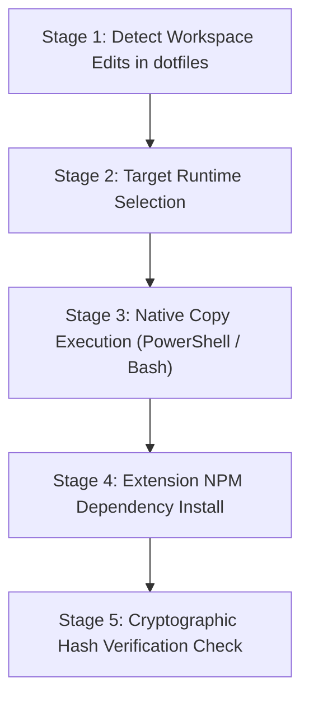

# Dotfiles Agent Sync Guide & Architecture Reference

Deterministic state machine and copy procedures to synchronize agent skills, extensions, prompts, and configurations from the `dotfiles` repository to global runtime directories (`~/.pi/agent` and `~/.gemini/config/skills`).

---

## 1. Process State Machine & Circuit Breakers



| Primitive / Trap | Operational Hazard & Behavior | Required Affirmative Protocol |
| :--- | :--- | :--- |
| **Editing Destination Directly** | Directly modifying `~/.pi/agent/` creates unversioned drift overwritten on next sync | Always edit source files in `pi-agent/Pi_Config/agent/` |
| **Verbose Output Flooding** | Running verbose sync commands (`rsync -av`) prints hundreds of lines of file lists | Use quiet sync flags (`Copy-Item -Force` or `rsync -aq`) |
| **Node Modules Sync Poisoning**| Copying host `node_modules` across platforms or into isolated runtimes corrupts native binaries | Always exclude `node_modules` and `package-lock.json` during sync |
| **Runtime Dependency Desync** | Modifying extension package imports without updating npm leaves runtime in broken state | Always run `npm install --no-fund --no-audit` in the target npm environment |

---

## 2. Source & Target Runtime Directory Matrix

| Target Runtime | Target Global Path | Source Directory in Dotfiles | Inclusion Policy |
| :--- | :--- | :--- | :--- |
| **Pi Agent Global** | `~/.pi/agent/` | `pi-agent/Pi_Config/agent/` | Complete synchronization of all prompts, extensions, skills, and settings. |
| **Antigravity Global** | `~/.gemini/config/skills/` | `pi-agent/Pi_Config/agent/skills/` | Sync portable skills; exclude Pi-only skills (`agent-config`, `batch-automator`). |
| **Pi NPM Environment** | `~/.pi/agent/npm/` | `pi-agent/Pi_Config/agent/npm/` | Extension dependency root for JITI runtime execution. |

---

## 3. High-Leverage Composite Sync Examples

### Example 1: Full Synchronization (Windows PowerShell)

```powershell
# Stage 3: Native Copy Execution (Pi Agent + Antigravity portable skills)
Copy-Item -Path "$HOME\Build\dotfiles\pi-agent\Pi_Config\agent\*" -Destination (Join-Path $HOME ".pi\agent") -Recurse -Force
Copy-Item -Path "$HOME\Build\dotfiles\pi-agent\Pi_Config\agent\skills\*" -Destination (Join-Path $HOME ".gemini\config\skills") -Exclude @("agent-config", "batch-automator") -Recurse -Force

# Stage 4: Extension NPM Dependency Install
npm --prefix (Join-Path $HOME ".pi\agent\npm") install --no-fund --no-audit

# Stage 5: Cryptographic Hash Verification Check
Get-FileHash (Join-Path $HOME "Build\dotfiles\pi-agent\Pi_Config\agent\skills\image-prompt-builder\SKILL.md"), `
             (Join-Path $HOME ".pi\agent\skills\image-prompt-builder\SKILL.md"), `
             (Join-Path $HOME ".gemini\config\skills\image-prompt-builder\SKILL.md") | Format-Table -Property Path, Hash
```

### Example 2: Full Synchronization (Linux / macOS / WSL)

```bash
# Stage 3: Native Copy Execution (excluding node_modules and Pi-only skills)
rsync -aq --exclude="node_modules" --exclude="package-lock.json" "$HOME/Build/dotfiles/pi-agent/Pi_Config/agent/" "$HOME/.pi/agent/"
rsync -aq --exclude="agent-config" --exclude="batch-automator" "$HOME/Build/dotfiles/pi-agent/Pi_Config/agent/skills/" "$HOME/.gemini/config/skills/"

# Stage 4: Extension NPM Dependency Install
npm --prefix "$HOME/.pi/agent/npm" install --no-fund --no-audit

# Stage 5: Cryptographic Hash Verification Check
sha256sum "$HOME/Build/dotfiles/pi-agent/Pi_Config/agent/skills/image-prompt-builder/SKILL.md" \
          "$HOME/.pi/agent/skills/image-prompt-builder/SKILL.md" \
          "$HOME/.gemini/config/skills/image-prompt-builder/SKILL.md"
```
