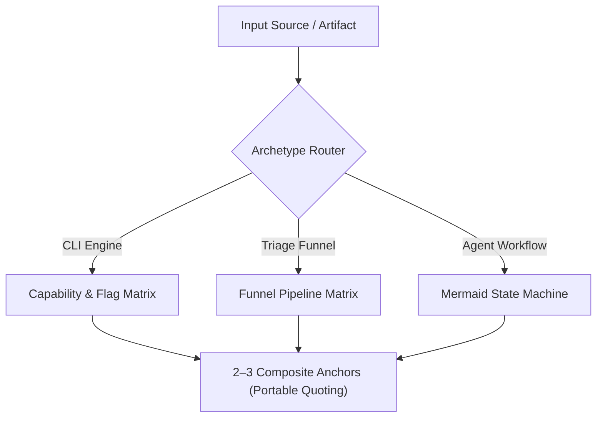

# Agent Skill Authoring & Architecture Blueprint

A definitive guide for designing, structuring, and optimizing AI agent skills across diverse tool domains. Enforces progressive disclosure, token efficiency, high-density capability matrices, cross-platform shell portability, and archetype-specific design patterns.

---

## 1. Core Philosophy: Capability Flags vs. Verbose Tutorials

Modern foundation models are pre-trained on programming languages, standard SQL dialects, POSIX tools, and major APIs. They do not need basic tutorials explaining fundamental concepts (e.g. what `WHERE` or `grep` does).

### The Dialect & Hallucination Problem
Models fail primarily due to **dialect uncertainty** (e.g., *"Does DuckDB support QUALIFY?"*, *"Does yq use strenv() or env()?"*, *"Does ast-grep use $VAR or $$$VAR?"*).

### The Core Principles of Skill Design:
1. **Capability Matrices over Tutorials:** Replace multi-page prose tutorials with compact, high-density reference tables detailing exact supported flags, keywords, and dialect behaviors.
2. **2–3 High-Leverage Composite Examples:** Always include 2–3 real-world composite commands, prompts, or workflows showing how flags, quoting, and pipe chaining combine in practice to anchor execution.
3. **Cross-Platform Shell Portability:** Ensure composite command examples use portable, non-conflicting quoting across PowerShell (`pwsh`) and POSIX shells (`bash`/`zsh`). Avoid ambiguous nested double-quotes that break subshell string interpolation.
4. **Tool Fast-Paths First:** When a skill provides deterministic helper scripts in `scripts/` (e.g. `scripts/vt_summary.py` or `scripts/pii_analyzer.py`), document them in *Programs Used* and feature them as *Example 1* to minimize token waste and eliminate complex multi-step tool calls.
5. **Single Working Memory vs. Modular Splitting:**
   - **Keep Unified (High-Density Monolith ~120–250 lines):** When a domain requires multiple tight rules to co-occur in active memory to produce valid output (e.g. OpenSCAD SSA scoping + BOSL2 attachment tags + headless render flags; or Prompt Builder FACS Action Units + optics + lighting tokens). Avoid over-splitting tightly coupled rules into separate files, which causes "lazy retrieval" and hallucinations in smaller models.
   - **Delegate to `references/` (Progressive Disclosure):** Strictly for massive secondary lookup dictionaries (e.g. 200+ raw API event schemas, exhaustive vendor field lists, historical changelogs) that are only consulted during deep forensic pivots.
6. **Token Density over Arbitrary Line Budgets:** Eliminate conversational filler, redundant tool explanations, and textbook tutorials, but preserve 100% of the critical domain rules, negative guardrails, and syntax quirks.

---

## 2. Standard Multi-File Directory Layout

Skills must strictly adhere to the standard multi-file layout:

```text
[skill-name]/
├── SKILL.md              # Required: Main entry point, capability matrices, and 2-3 examples
├── references/           # Optional: Heavy domain manuals, API catalogs, taxonomies (loaded on-demand)
├── scripts/              # Optional: Deterministic helper scripts (Python, Bash, JS)
├── examples/             # Optional: 30+ line code templates, extension boilerplates, sample configs
└── assets/               # Optional: Schemas, binaries, test fixtures
```

---

## 3. The 5 Skill Archetypes & Structural Blueprints

Do not force a single rigid format onto fundamentally different domains. Choose the archetype that fits the skill's operational purpose:

### Archetype 1: Single / Multi-CLI Tools
* **Target Skills:** `duckdb`, `yq`, `mlr`, `ast-grep`, `gh`, `snyk`, `vt-cli`, `docling`, `ck`
* **Structural Flow:**
  1. `## 1. Programs Used` (Include bundled `scripts/` fast-paths)
  2. `## 2. Negative Guardrails & Headless Execution Safety` (Quoting, bounds, memory, exit codes)
  3. `## 3. Supported Formats / Scan Engines Matrix`
  4. `## 4. Dialect & Syntax Flags Matrix` (Operators, keywords, function families)
  5. `## 5. High-Leverage Composite Examples` (Example 1 = Fast-path helper if present, followed by portable CLI one-liners)

### Archetype 2: Multi-Tool Triage & Investigation Funnels
* **Target Skills:** `pe-malware-triage`, `doc-malware-triage`, `pii-detection`, `log-analysis`
* **Structural Flow:**
  1. `## 1. Safety & Isolation Guardrails` (Quarantine, non-execution, temp directories)
  2. `## 2. Investigation Funnel Pipeline Matrix` (Stage $\rightarrow$ Tool $\rightarrow$ Exact One-Liner $\rightarrow$ Finding Signal)
  3. `## 3. Tool-Specific Capability & Flag Reference`
  4. `## 4. Structured Output / Finding JSON Schema`
  5. `## 5. High-Leverage Composite Triage Examples` (2–3 end-to-end investigation flows)

### Archetype 3: Workflow, Planning & Process State Machines
* **Target Skills:** `plan-execute`, `dotfiles-sync`, `batch-automator`, `agent-config`
* **Structural Flow:**
  1. `## 1. Process Overview & State Machine` (Mermaid flowchart of phases)
  2. `## 2. Phase Transition & Circuit-Breaker Rules` (Execution rules, stopping conditions)
  3. `## 3. Interactive User Confirmation Protocols` (Gating rules, review gates)
  4. `## 4. Artifact & Plan Document Schema` (Living `PLAN.md` template or config matrix)
  5. `## 5. High-Leverage Workflow Examples` (2–3 multi-phase execution scenarios)

### Archetype 4: Declarative DSLs & Headless Compilers
* **Target Skills:** `openscad`
* **Structural Flow:**
  1. `## 1. Headless Compiler & Render Matrix` (CLI flags, camera matrices, image sizes, export formats)
  2. `## 2. Core DSL & Semantic Attachment Matrix` (Attachment anchors, tag-based booleans, differences)
  3. `## 3. Negative Syntax Traps & Performance Guardrails` (Resolution LOD, SSA variable rules)
  4. `## 4. High-Leverage Parametric Recipes` (2–3 complete CSG/BOSL2 component models)

### Archetype 5: Generative Staging & Prompt Builders
* **Target Skills:** `image-prompt-builder`
* **Structural Flow:**
  1. `## 1. Optical Staging & Optics Matrix` (Focal lengths, apertures, lighting setups, shot types)
  2. `## 2. FACS Anatomical Mechanics Matrix` (Action Units, micro-expressions, facial tensions)
  3. `## 3. Engine Dialect Modifiers` (Krea 2 RAW, ANIMA anime, Flux, Midjourney)
  4. `## 4. Negative Prompt & Quality Guardrails`
  5. `## 5. Exemplar Composite Prompt Stacks` (2–3 complete production-grade prompts)

---

## 4. Diagram Standards: Native Mermaid Only

> [!IMPORTANT]
> **Zero ASCII Box Art:**
> Never use ASCII character boxes (`┌`, `└`, `│`, `─`). They waste vertical context tokens, wrap awkwardly across terminal widths, and break markdown linters. Always use native **Mermaid diagrams** (`flowchart TD`, `sequenceDiagram`, `stateDiagram-v2`).



---

## 5. Universal Do's and Don'ts Checklist

| Dimension | ✅ DO | ❌ DON'T |
| :--- | :--- | :--- |
| **Token Density** | Use compact Markdown tables for flags, operators, and parameters. | Write conversational paragraphs explaining basic computer science or SQL basics. |
| **Fast-Paths** | List bundled `scripts/` helpers and prioritize them as Example 1. | Omit helper scripts or force models to reconstruct complex multi-step pipelines. |
| **Shell Portability** | Write cross-platform shell commands that execute reliably in PowerShell and Bash. | Use ambiguous nested double-quotes that break string interpolation across shells. |
| **Output Bounding** | Always enforce bounds on exploratory commands (`LIMIT 25`, `head -n 20`, `-I --limit 20`). | Emit unbounded commands that flood terminal buffers (`SELECT *`, `cat massive.log`). |
| **Path Escaping** | Enforce single-quotes for file paths in SQL/APIs (`FROM 'file.parquet'`). | Use unquoted or double-quoted filenames in SQL clauses (`FROM "file.parquet"`). |
| **Non-Interactive** | Enforce headless, non-interactive flags (`-bail`, `--no-prompt`, `-U`, `--approve`). | Invoke interactive TUIs or prompts (`lnav`, `snyk auth` without token, `sg -i` in scripts). |
| **Media & Images** | Use lightweight placeholders (`--image-export-mode placeholder`). | Embed raw base64 data URIs (`data:image/png;base64,...`) which blow out context windows. |
| **Code Bloat** | Move 30+ line code templates into `examples/` or `scripts/`. | Embed massive 200-line TypeScript or Python classes directly in `SKILL.md`. |
| **File Structure** | Put secondary domain manuals into `references/<name>.md`. | Leave loose `.md` files cluttering the skill root folder. |
