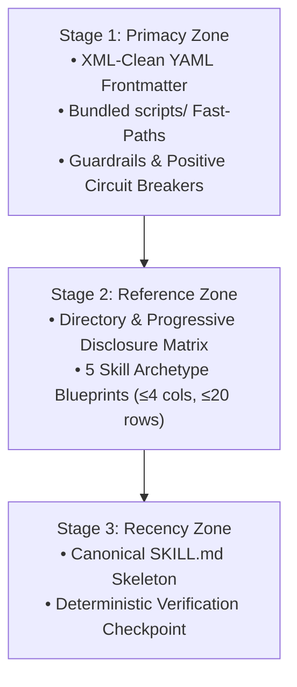
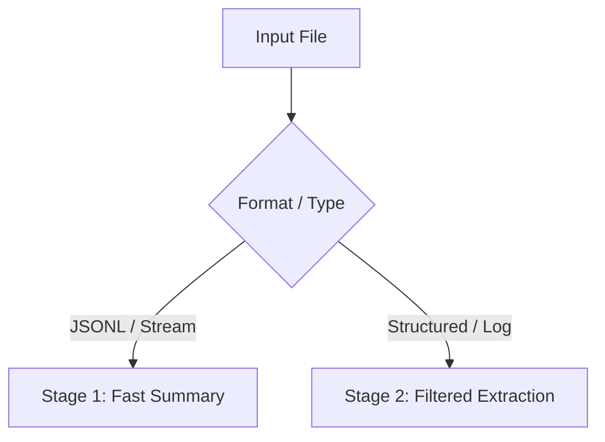

# Agent Skill Authoring & Architecture Blueprint

Standardized architecture for authoring, auditing, and refactoring `SKILL.md` files that execute reliably across both small local agents (e.g., Gemma 4 12B) and SOTA frontier models (e.g., Gemini 4).

---

## 1. Stage 1: Primacy Zone — Positional Layout & Authoring Guardrails

Both 12B SLMs and frontier models exhibit a U-shaped attention curve ("Lost in the Middle"). Structure every `SKILL.md` using the **Primacy–Matrix–Recency Sandwich** and enforce the guardrails below:



| Dimension | Operational Trap & Why It Fails on 12B / SOTA | Required Affirmative Rule & Syntax |
| :--- | :--- | :--- |
| **Induction-Head Safety** | Including broken code snippets or invalid flags in examples causes 12B induction heads to copy them verbatim into tool calls. | Describe traps strictly in plain English prose; ensure **100% of backticked spans are valid, executable syntax**. |
| **Frontmatter XML Hygiene** | Single/double quotes, angle brackets, ampersands, or unquoted colons with spaces trigger XML entity escaping or YAML parser errors. | Write clean unquoted `description` strings with action verbs, file extensions, and bare uppercase tokens (`FILE`, `PATTERN`, `LANG`). |
| **Split Placeholders** | Using uppercase placeholders or dummy words (foo, bar, example domains) inside bottom examples causes 12B literal echoing. | Use bare uppercase tokens (`FILE`, `LANG`) in frontmatter/tables, and **realistic domain paths** (`'logs/events.parquet'`, `suspect.exe`) in bottom examples. |
| **Lexical Anchoring** | Swapping synonyms across sections (e.g., *Triage* vs. *Recon* vs. *Initial Scan*) causes 12B attention-head synonym drift. | Use the **exact same stage names** across Mermaid nodes, table headers, and `# Stage N:` example comments. |
| **Table Geometry** | Wide 7+ column tables or 80-row monolithic tables cause horizontal token-alignment drift and middle-row amnesia in 12B models. | Cap Markdown tables at **$\le 4$ columns** and **$\le 20$ rows** per table. |
| **Fast-Paths First** | Chaining 5 raw CLI flags from scratch increases 12B syntax hallucination risk and wastes multi-turn tokens. | Bundle deterministic helpers in `scripts/` (e.g., `uv run scripts/pe_summary.py suspect.exe`), list them in Section 1, and feature them as Example 1. |
| **Circuit Breakers** | Leaving error recovery implicit or writing bare prohibitions causes 12B models to repeat failing commands in an infinite loop. | Frame recovery with positive projection: *"If command X exits with an error, immediately switch to command Y."* |
| **Output Signal Hygiene** | Progress bars, ANSI color codes, and deeply nested pretty-printed JSON waste 30–50% of context tokens and accelerate context rot. | Enforce `--no-progress`, `--no-color`, `-q`; use `-markdown`, TSV, or `jq -r` when the LLM reads stdout directly, and `-json` when piping. |
| **Output & Memory Bounds** | Unbounded table scans, full-file dumps, or uncapped in-memory joins overflow terminal buffers and subshell RAM. | Always append row/line bounds (`LIMIT 25`, `head -n 20`, `--limit 20`) and memory ceilings (`SET max_memory = '4GB';`). |
| **Headless & Idempotent** | Interactive TUIs hang subshells; non-idempotent commands fail or duplicate state on agent retry turns. | Enforce headless flags (`-bail`, `--no-prompt`, `-U`) and retry-safe operations (`CREATE OR REPLACE`, `OVERWRITE_OR_IGNORE true`, `-Force`). |
| **Verification Checkpoints** | Assuming exit code `0` means success fails when a command silently writes zero rows or empty artifacts. | Append a **1-line deterministic verification check** (row count, file hash, or preview render) at the end of mutating workflow examples. |
| **Shell & Path Portability** | Double-quoted SQL file paths parse as column identifiers; nested double-quotes break across PowerShell and Bash. | Single-quote file paths inside SQL/DSLs (`FROM 'data.parquet'`) and use cross-platform quoting in shell blocks. |
| **Diagram Policy & Hygiene** | Linear Mermaid diagrams in CLI tools waste 40–80 tokens on human theater without reasoning benefit; box-drawing characters break linters. | Reserve **Mermaid diagrams** strictly for **multi-path branching (triage funnels) and cyclic state machines (retry loops)**. For linear CLI tools, omit diagrams and use Markdown tables. Zero Unicode box characters. |

---

## 2. Stage 2: Reference Zone — Directory & Archetype Matrices

### Directory & Progressive Disclosure Matrix

| Skill Path | Status | Token Budget & Progressive Disclosure Rule |
| :--- | :--- | :--- |
| `SKILL.md` | **Required** | Co-locate all core flags, guardrails, workflow stages, and 2–3 composite examples in active memory to prevent 12B lazy retrieval. Offload deep reference catalogs to `references/`. |
| `scripts/` | Optional | **Zero context cost until executed.** Bundle deterministic Python/Bash/JS helpers (`scripts/pe_summary.py`) and feature them as Example 1. |
| `references/` | Optional | **Loaded on demand.** Offload deep vendor API catalogs or rare sub-workflows (`references/ghidra-headless.md`). Always state the exact trigger condition in `SKILL.md`. |
| `examples/` | Optional | **Loaded on demand.** Store extensive boilerplate classes, config templates, or complex multi-file scaffolds outside `SKILL.md`. |
| `assets/` | Optional | **Static resources.** Store JSON schemas, binary fixtures, or lookup dictionaries consumed by `scripts/`. |

### 5 Skill Archetype Blueprints

Select the archetype that matches the skill's domain. Every archetype follows the **Stage 1: Primacy Zone $\rightarrow$ Stage 2: Reference Zone $\rightarrow$ Stage 3: Recency Zone** progression:

| Archetype | Target Skills | Required Section Progression (1:1 Lexical Anchors) | Recency Zone Deliverable |
| :--- | :--- | :--- | :--- |
| **1. Single / Multi-CLI Tools** | `uv`, `duckdb`, `yq`, `mlr`, `ast-grep`, `gh`, `snyk`, `semgrep`, `secret-scanning`, `vt-cli`, `docling`, `ck` | `1. Execution Primitives & Circuit Breakers` $\rightarrow$ `2. Formats / Engines Matrix` $\rightarrow$ `3. Dialect & Flags Matrix` $\rightarrow$ `4. High-Leverage Composite Examples`<br/>*(Omit Mermaid: linear CLI tools use Markdown tables to eliminate token bloat)* | Example 1 = `scripts/` fast-path; Examples 2–3 = bounded headless pipelines. |
| **2. Multi-Tool Triage Funnels** | `pe-malware-triage`, `doc-malware-triage`, `pii-detection`, `log-analysis` | `1. Toolchain, Quarantine & Circuit Breakers` $\rightarrow$ `2. Investigation Funnel Matrix` (Mermaid Branching Tree + Table) $\rightarrow$ `3. Tool Flag Reference` $\rightarrow$ `4. Output Schema` $\rightarrow$ `5. Composite Triage Examples` | 2–3 end-to-end triage pipelines with `# Stage N:` comments matching Section 2. |
| **3. Workflow State Machines** | `plan-execute`, `dotfiles-sync`, `batch-automator`, `agent-config` | `1. Process State Machine & Circuit Breakers` (Mermaid Cyclic State Machine) $\rightarrow$ `2. Confirmation & Dry-Run Gates` $\rightarrow$ `3. Artifact / Config Schema` $\rightarrow$ `4. Composite Workflow Examples` | Multi-phase execution blocks ending with a file-hash or diff verification step. |
| **4. Declarative DSL Compilers** | `openscad` | `1. Headless Compiler, Guardrails & Render Matrix` $\rightarrow$ `2. Core DSL & Attachment Matrix` $\rightarrow$ `3. Parametric Recipes & Verification` | 2–3 parametric models followed by headless PNG render + visual inspection. |
| **5. Generative Prompt Staging** | `image-prompt-builder` | `1. Quality Guardrails & Engine Modifiers` $\rightarrow$ `2. Optical Staging Matrix` $\rightarrow$ `3. FACS / Subject Matrix` $\rightarrow$ `4. Exemplar Composite Prompt Stacks` | 2–3 production-grade multi-layer prompts with negative prompt stacks. |

---

## 3. Stage 3: Recency Zone — Canonical `SKILL.md` Skeleton & Verification

### Example 1: Canonical `SKILL.md` Skeleton

````markdown
---
name: tool-name
description: Action-oriented summary with file extensions and literal flags (e.g. tool-cli --json --bail FILE).
---

# Tool Name & 1-Sentence Operational Scope

## 1. Execution Primitives, Fast-Paths & Circuit Breakers

| Flag / Script / Rule | Operational Trap & Purpose | Required Affirmative Syntax |
| :--- | :--- | :--- |
| `uv run scripts/fast_summary.py` | Eliminates manual multi-step parsing errors | `uv run scripts/fast_summary.py logs/app.jsonl` |
| `--json --bail --no-progress` | Prevents interactive hangs and spinner noise | `tool-cli --json --bail --no-progress FILE` |
| **Error Circuit Breaker** | Prevents retry loops on corrupt records | If exit code != 0, switch to `tool-cli --salvage FILE` |

## 2. Investigation Funnel & Capability Matrix



| Stage | Focus | Exact Command (`FILE` / `PATTERN`) | Finding Signal |
| :--- | :--- | :--- | :--- |
| **Stage 1: Fast Summary** | Schema & row stats | `uv run scripts/fast_summary.py FILE` | Identifies corrupt partitions |
| **Stage 2: Filtered Extraction** | Bounded record slice | `tool-cli --json --bail -p PATTERN --limit 25 FILE` | Emits matching JSON records |

## 3. High-Leverage Composite Examples

```bash
# Stage 1: Fast Summary using bundled helper script
uv run scripts/fast_summary.py logs/auth_2026.jsonl

# Stage 2: Filtered Extraction with bounded output and verification count
tool-cli --json --bail --no-progress -p "status >= 500" --limit 25 logs/auth_2026.jsonl > errors.json
jq 'length' errors.json
```
````

### Example 2: Deterministic Verification Checkpoint

```bash
# Stage 3: Recency Zone — Deterministic Verification Checkpoint (XML-clean description, zero box chars)
uv run -q --no-project python -c "import pathlib, re, sys; p = pathlib.Path('.agents/skills/skill-authoring/SKILL.md'); txt = p.read_text(encoding='utf-8'); desc = re.search(r'^description:\s*(.+)$', txt, re.M).group(1); bad_xml = re.findall(r'[\x22\x27<>&]|:\s', desc); bad_box = re.findall(r'[\u2500-\u257f]', txt); print(f'XML-unsafe: {bad_xml} | Box chars: {len(bad_box)}'); sys.exit(1 if bad_xml or bad_box else 0)"
```
