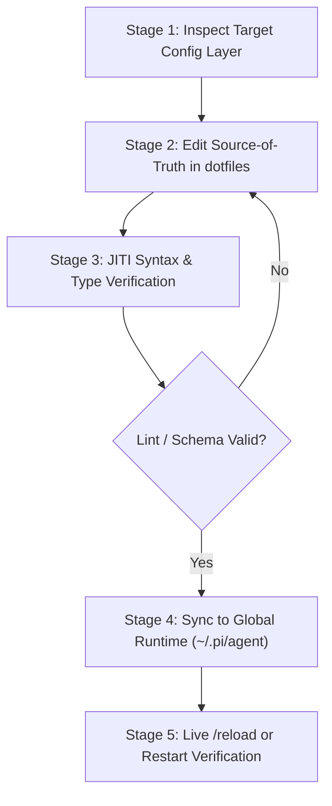

# Pi Agent Configuration & Architecture Blueprint

Complete configuration guide and lifecycle API reference for the Pi Coding Agent (`@earendil-works/pi-coding-agent`).

---

## 1. Process State Machine & Circuit Breakers



| Primitive / Trap | Operational Hazard & Behavior | Required Affirmative Protocol |
| :--- | :--- | :--- |
| **Editing Global Destination Directly** | Direct edits in `~/.pi/agent/` are overwritten on subsequent repository syncs | Always modify source files in `pi-agent/Pi_Config/agent/` first |
| **JITI Extension Runtime Crash** | Syntax errors or missing types in `.ts` extensions crash agent startup | Run type checks or verify against `examples/extension_blueprint.ts` before reload |
| **UI Dialog Overwrite Invariant** | Multiple extensions opening UI dialogs concurrently overwrite the terminal slot | Always serialize interactive extension dialogs through `globalThis.__piDialogQueue` |
| **Tool Name Registration Collision** | Two extensions registering the same tool name cause fatal startup error | Enforce unique tool names; use lifecycle hooks (`pi.on("tool_call")`) for cross-cutting logic |
| **JSON Comment Syntax Error** | Adding comments (`//`) to `models.json` or `settings.json` breaks JSON parsers | Always ensure configuration JSON files are strictly RFC 8259 compliant |

---

## 2. Configuration Layers & Placement Matrix

| Goal / Layer | File Path (Local / Global) | Load Behavior | Purpose / Capabilities |
| :--- | :--- | :--- | :--- |
| **Behavioral Rules** | `.pi/AGENTS.md`, `~/.pi/agent/AGENTS.md` | Auto-loaded | Primary agent persona, development workflows, and methodologies. |
| **Environment Layer**| `.pi/APPEND_SYSTEM.md`, `~/.pi/agent/APPEND_SYSTEM.md` | Auto-loaded | Platform shell defaults, terminal constraints, line endings. |
| **Agent Settings** | `.pi/settings.json`, `~/.pi/agent/settings.json` | `/reload` | Default model, theme selection, editor binding (`"code --wait"`). |
| **MCP Tool Servers** | `.pi/mcp.json`, `~/.pi/agent/mcp.json` | `/reload` | External stdio and HTTP Model Context Protocol integrations. |
| **Model Endpoints** | `~/.pi/agent/models.json` | `/reload` | Local LLM endpoints (Ollama, llama-swap, vLLM) and compatible APIs. |
| **Agent Skills** | `.pi/skills/NAME/SKILL.md` | Auto-loaded | Domain workflows, tool capability matrices, multi-file rules. |
| **Custom Extensions**| `.pi/extensions/NAME.ts`, `~/.pi/agent/extensions/NAME.ts` | `/reload` | TypeScript modules registering tools, slash commands, or event hooks. |
| **Prompt Shortcuts** | `.pi/prompts/NAME.md`, `~/.pi/agent/prompts/NAME.md` | `/reload` | Parameterized prompt templates expanded via `$@`, `$1`, `${1:-default}`. |
| **UI Themes** | `.pi/themes/NAME.json`, `~/.pi/agent/themes/NAME.json` | Auto-loaded | Custom hex / ANSI-256 color palettes for terminal styling. |

---

## 3. Extensions API & Lifecycle Hooks Matrix

Compiled on-the-fly via JITI. Only **one** extension can register a specific tool name; multiple extensions can hook the same lifecycle events without conflict:

| API Method / Hook | Purpose | Behavioral Rule / Conflict Handling |
| :--- | :--- | :--- |
| **`pi.registerTool({...})`** | Registers new LLM-callable tool | **Unique name required.** Defines `parameters` (TypeBox), `execute`, and `renderCall`. |
| **`pi.registerCommand(name, {...})`**| Registers user slash command (`/name`) | Executes interactive UI commands; supports tab autocompletion. |
| **`pi.registerFlag(name, {...})`** | Registers custom CLI flag | Injects `--name` flags queried at runtime via `pi.getFlag("name")`. |
| **`pi.on("tool_call", async (e, ctx))`** | Pre-execution lifecycle hook | Zero conflicts. Inspects or blocks commands (`return { block: true, reason: "..." }`). |
| **`pi.on("tool_result", async (e, ctx))`**| Post-execution lifecycle hook | Zero conflicts. Formats, enriches, or logs tool results non-destructively. |
| **`pi.on("session_start", async (e))`** | Session initialization hook | Runs setup scripts, resets mutex queues, or synchronizes status bar items. |

Consult [`references/extension_playbook.md`](references/extension_playbook.md) for headless test harnesses and type reflection patterns.

---

## 4. High-Leverage Composite Examples

```bash
# Stage 1: Configure local LLM endpoint (~/.pi/agent/models.json)
cat << 'EOF' > ~/.pi/agent/models.json
{
  "providers": {
    "local-llama": {
      "baseUrl": "http://127.0.0.1:8080/v1",
      "apiKey": "not-needed",
      "api": "openai-completions",
      "models": [
        {
          "id": "unsloth/gemma-4-12b-it-GGUF:UD-Q4_K_XL",
          "name": "Local Gemma 4 12B",
          "input": ["text"],
          "contextWindow": 131072,
          "maxTokens": 4096
        }
      ]
    }
  }
}
EOF
jq '.providers."local-llama".models[0].id' ~/.pi/agent/models.json

# Stage 2: Register a safety permission gate extension (.pi/extensions/security-gate.ts)
cat << 'EOF' > .pi/extensions/security-gate.ts
import type { ExtensionAPI } from "@earendil-works/pi-coding-agent";
import { isToolCallEventType } from "@earendil-works/pi-coding-agent";

export default function (pi: ExtensionAPI) {
  pi.on("tool_call", async (event, ctx) => {
    if (isToolCallEventType("bash", event)) {
      if (/git\s+clean\s+-[a-zA-Z]*f/i.test(event.input.command || "")) {
        return { block: true, reason: "Blocked: Untracked file deletion prohibited." };
      }
    }
  });
}
EOF
```
