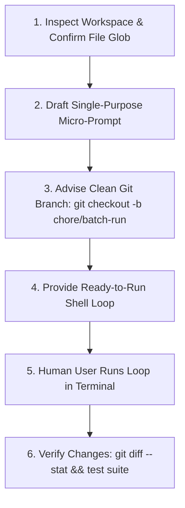

# Batch Automator (Headless `pi -p` Loops) Reference

Guides agents on generating ready-to-run, isolated shell loops for human engineers to execute large-scale batch refactoring, migrations, or docstring generation across hundreds of files using **headless `pi -p` execution**.

---

## 1. Execution Policy & Headless Fail-Safe Guardrails

> [!IMPORTANT]
> **Anti-Self-Execution Policy:**
> **Do NOT execute bulk batch loops yourself in agent tool calls.** Inspect the workspace pattern, draft the single-purpose `pi -p` prompt, and provide the copy-paste PowerShell or Bash command for the **user to run in their own terminal**.

| Hallucination / Mistake | Why It Fails | Correct Protocol / Syntax |
| :--- | :--- | :--- |
| Interactive `ask_question` call | Subshell hangs waiting for STDIN in headless mode | Always append `--exclude-tools ask_question` |
| Version check on every iteration | Spawns npm registry network checks for every file | Export `PI_SKIP_VERSION_CHECK=1` before loop |
| IPv6 DNS lookup stalls | Stalls Node.js network requests on certain systems | Export `NODE_OPTIONS="--dns-result-order=ipv4first"` |
| Session file flooding | Creates hundreds of junk `.jsonl` session files on disk | Always pass `--no-session` |
| Extension confirmation prompts | Prompts user on every iteration for local tools | Pass `--approve` (`-a`) |
| Unbounded hang on single stall | Freezes entire multi-hour loop on one stalled API call | Add `90s` wall-clock timeout per iteration |

---

## 2. Headless Loop Parameter Matrix

| Parameter / Flag | Type | Purpose & Behavior |
| :--- | :--- | :--- |
| `pi -p` | Headless binary | Non-interactive prompt execution mode. |
| `--approve` (`-a`) | Flag | Auto-approves project-local extensions, tools, and prompts. |
| `--no-session` | Flag | Disables session transcript persistence to disk. |
| `--tools "read,write"` | Allowlist | Restricts tool execution strictly to required operations. |
| `--exclude-tools ask_question` | Denylist | Strips interactive questioning tools from agent capabilities. |
| `@<filepath>` | Target file | Injects file contents directly into fresh ~2,000-token micro-context. |

---

## 3. Workflow State Machine



---

## 4. High-Leverage Composite Loop Templates

### Template 1: Standard Sequential Transformation Loop

#### Windows (PowerShell)
```powershell
git checkout -b chore/batch-refactor
$env:PI_SKIP_VERSION_CHECK = "1"
$env:NODE_OPTIONS = "--dns-result-order=ipv4first"

Get-ChildItem -Path src/ -Filter *.ts -Recurse | Where-Object { $_.FullName -notmatch "node_modules|\.git" } | ForEach-Object {
    $file = $_.FullName
    Write-Host "➡️ Processing: $($_.Name)"
    pi -p --approve --no-session --tools "read,write" --exclude-tools ask_question "@$file" "<USER_TASK_PROMPT_HERE>"
}
git diff --stat
```

#### Linux / macOS (Bash)
```bash
git checkout -b chore/batch-refactor
export PI_SKIP_VERSION_CHECK=1
export NODE_OPTIONS="--dns-result-order=ipv4first"

find src/ -name "*.ts" -not -path "*/node_modules/*" | while read -r file; do
    echo "➡️ Processing: $file"
    timeout 90s pi -p --approve --no-session --tools "read,write" --exclude-tools ask_question "@$file" "<USER_TASK_PROMPT_HERE>"
done
git diff --stat
```

---

### Template 2: Resumable Batch Loop with State File (`.batch_done.txt`)

#### Windows (PowerShell)
```powershell
$doneFile = ".batch_done.txt"
if (!(Test-Path $doneFile)) { New-Item $doneFile -ItemType File | Out-Null }
$env:PI_SKIP_VERSION_CHECK = "1"
$env:NODE_OPTIONS = "--dns-result-order=ipv4first"

Get-ChildItem -Path src/ -Filter *.ts -Recurse | Where-Object { 
    $done = Get-Content $doneFile
    $done -notcontains $_.FullName -and $_.FullName -notmatch "node_modules|\.git"
} | ForEach-Object {
    $file = $_.FullName
    Write-Host "Processing: $($_.Name)..."
    pi -p --approve --no-session --tools "read,write" --exclude-tools ask_question "@$file" "<USER_TASK_PROMPT_HERE>"
    if ($LASTEXITCODE -eq 0) { Add-Content -Path $doneFile -Value $file }
}
```

#### Linux / macOS (Bash)
```bash
touch .batch_done.txt
export PI_SKIP_VERSION_CHECK=1
export NODE_OPTIONS="--dns-result-order=ipv4first"

find src/ -name "*.ts" -not -path "*/node_modules/*" | while read -r file; do
    if grep -Fxq "$file" .batch_done.txt; then
        echo "⏭️ Skipping: $file"
        continue
    fi
    echo "➡️ Processing: $file"
    if timeout 90s pi -p --approve --no-session --tools "read,write" --exclude-tools ask_question "@$file" "<USER_TASK_PROMPT_HERE>"; then
        echo "$file" >> .batch_done.txt
    fi
done
```

---

### Template 3: Read-Only Audit & Markdown Report Aggregation

#### Windows (PowerShell)
```powershell
$report = "audit_report.md"
"# Codebase Audit Report`n`n| File | Status | Issue |`n| :--- | :--- | :--- |" | Set-Content $report
$env:PI_SKIP_VERSION_CHECK = "1"

Get-ChildItem -Path src/ -Filter *.ts -Recurse | Where-Object { $_.FullName -notmatch "node_modules|\.git" } | ForEach-Object {
    $file = $_.FullName
    Write-Host "Scanning: $($_.Name)"
    $res = pi -p --approve --no-session --tools read --exclude-tools ask_question "@$file" "Audit this file for raw SQL strings. Output format: STATUS | ISSUE"
    "| $($_.Name) | $res |" | Add-Content $report
}
```
