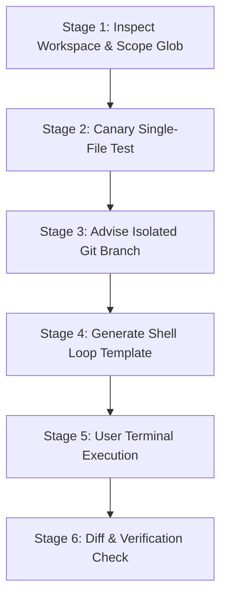

# Batch Automator (Headless `pi -p` Loops) Reference

Guides agents on generating ready-to-run, isolated shell loops for human engineers to execute large-scale batch refactoring, migrations, or docstring generation across hundreds of files using **headless `pi -p` execution**.

---

## 1. Process State Machine & Circuit Breakers



| Primitive / Trap | Operational Hazard & Behavior | Required Affirmative Protocol |
| :--- | :--- | :--- |
| **Direct Agent Self-Execution** | Running bulk multi-file loops directly inside agent tool calls hits tool timeouts | Draft the loop command and present it to the human user to run in their own terminal |
| **Interactive Question Hang** | Subshells hang indefinitely waiting for interactive user response | Always append `--exclude-tools ask_question` to headless calls |
| **Per-Iteration Registry Lag** | Checking npm registry versions on every iteration wastes network time | Export `PI_SKIP_VERSION_CHECK=1` prior to executing loop |
| **Session File Proliferation** | Creating hundreds of `.jsonl` transcript files clutters workspace | Always pass `--no-session` to headless loops |
| **Stalled API Call Circuit Breaker**| Single unresponsive model query freezes multi-hour batch runs | Wrap execution in a 90-second timeout per iteration |

---

## 2. Confirmation & Dry-Run Canary Gates

Before delivering a 100+ file loop command, always enforce the **Canary Gate**:
1. Run a single-file test: `pi -p --approve --no-session --tools "read,edit" "@src/canary.ts" "PROMPT"`.
2. Inspect the resulting `git diff src/canary.ts` to confirm edits are minimal, accurate, and syntax-safe.
3. Advise the user to create a clean branch before executing the full loop: `git checkout -b chore/batch-refactor`.

---

## 3. Headless Loop Parameter Matrix

| Parameter / Flag | Type | Purpose & Behavior |
| :--- | :--- | :--- |
| `pi -p` | Headless binary | Non-interactive prompt execution mode. |
| `--approve` (`-a`) | Flag | Auto-approves project-local extensions, tools, and prompts. |
| `--no-session` | Flag | Disables session transcript persistence to disk. |
| `--tools "read,edit,write"` | Allowlist | Restricts tool execution strictly to required operations. |
| `--exclude-tools ask_question` | Denylist | Strips interactive questioning tools from agent capabilities. |
| `@FILE_PATH` | Target file | Injects file contents directly into fresh micro-context. |

---

## 4. High-Leverage Composite Loop Templates

### Template 1: Standard Sequential Transformation Loop

#### Windows (PowerShell)
```powershell
# Stage 1: Advise isolated branch and set headless execution environment
git checkout -b chore/batch-refactor
$env:PI_SKIP_VERSION_CHECK = "1"
$env:PI_GATES = "0"
$env:NODE_OPTIONS = "--dns-result-order=ipv4first"

# Stage 2: Execute bounded sequential loop across target files
Get-ChildItem -Path src/ -Filter *.ts -Recurse | Where-Object { $_.FullName -notmatch "node_modules|\.git" } | ForEach-Object {
    $file = $_.FullName
    Write-Host "Processing: $($_.Name)"
    pi -p --approve --no-session --tools "read,edit,write" --exclude-tools ask_question "@$file" "Refactor deprecated fetch() calls to use apiClient.get(). Do not alter type signatures."
}

# Stage 3: Post-run verification
git diff --stat
```

#### Linux / macOS (Bash)
```bash
# Stage 1: Advise isolated branch and set headless execution environment
git checkout -b chore/batch-refactor
export PI_SKIP_VERSION_CHECK=1
export PI_GATES=0
export NODE_OPTIONS="--dns-result-order=ipv4first"

# Stage 2: Execute bounded sequential loop across target files
find src/ -name "*.ts" -not -path "*/node_modules/*" | while read -r file; do
    echo "Processing: $file"
    timeout 90s pi -p --approve --no-session --tools "read,edit,write" --exclude-tools ask_question "@$file" "Refactor deprecated fetch() calls to use apiClient.get(). Do not alter type signatures."
done

# Stage 3: Post-run verification
git diff --stat
```

---

### Template 2: Resumable Batch Loop with State File (`.batch_done.txt`)

#### Linux / macOS (Bash)
```bash
touch .batch_done.txt
export PI_SKIP_VERSION_CHECK=1
export PI_GATES=0
export NODE_OPTIONS="--dns-result-order=ipv4first"

find src/ -name "*.ts" -not -path "*/node_modules/*" | while read -r file; do
    if grep -Fxq "$file" .batch_done.txt; then
        echo "Skipping already completed: $file"
        continue
    fi
    echo "Processing: $file"
    if timeout 90s pi -p --approve --no-session --tools "read,edit,write" --exclude-tools ask_question "@$file" "Add strict JSDoc comments to all exported functions."; then
        echo "$file" >> .batch_done.txt
    fi
done
git diff --stat
```
