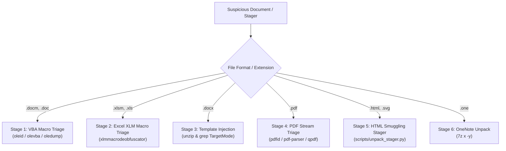

# Malicious Document & Phishing Stager Triage Reference

Static, non-executing triage of suspicious Microsoft Office documents, HTML smuggling attachments, Windows shortcuts (.lnk), OneNote packages, and PDFs to extract malicious macros, formulas, templates, embedded payloads, and IOCs.

---

## 1. Toolchain, Quarantine & Circuit Breakers

| Tool / Fast-Path | Operational Role & Capabilities | Safety Protocol / Circuit Breaker |
| :--- | :--- | :--- |
| **`uv run scripts/unpack_stager.py`** | Fast-path unpeeling of Base64 blobs, PE payloads, and defanging | Primary triage command: run first for HTML/SVG stagers and nested blobs. |
| **Application Isolation** | Opening suspect documents in Office or Adobe Reader triggers active exploits | Never open files in native desktop applications; parse strictly headlessly. |
| **Encrypted OLE Circuit Breaker** | Password-protected documents block static macro analysis | If encrypted with default key, run `msoffcrypto-tool FILE decrypted.docm -p VelvetSweatshop`. |
| **Headless Archive Extraction** | Interactive prompts in archive extractors hang background subshells | Always pass `-y` to 7-Zip: `7z x -y FILE -o./out/`. |
| **OOXML Template Injection** | Benign `.docx` files can fetch remote malicious `.dotm` stagers | Unpack and inspect `word/_rels/settings.xml.rels` for external TargetMode URLs. |

---

## 2. Investigation Funnel Matrix



| Stage | Vector / Threat Type | Parser Sequence | Key Detection Signal |
| :--- | :--- | :--- | :--- |
| **Stage 1: VBA Macro Triage** | VBA Macro / Dropper | `oleid FILE` &rarr; `olevba --decode FILE` | AutoExec triggers (`Document_Open`), shell executions. |
| **Stage 2: Excel XLM Macro Triage** | Excel 4.0 (XLM) Macro | `olevba FILE` &rarr; `xlmmacrodeobfuscator` | Hidden sheets, `EXEC()`, `URLDOWNLOADTOFILE()`, `CALL()`. |
| **Stage 3: Template Injection** | OOXML Remote Template | `unzip FILE` &rarr; `grep TargetMode="External"` | Remote template references fetching `.dotm` stagers. |
| **Stage 4: PDF Stream Triage** | JS / Launch Actions | `pdfid.py -e FILE` &rarr; `pdf-parser.py` | `/JavaScript`, `/Launch`, `/EmbeddedFiles`, `/OpenAction`. |
| **Stage 5: HTML Smuggling Stager** | HTML / SVG Attachment | `uv run scripts/unpack_stager.py FILE` | Base64 blob downloads (`URL.createObjectURL`). |
| **Stage 6: OneNote Unpack** | OneNote Container | `7z x -y FILE -o./out/` | Embedded batch scripts (`.bat`, `.vbs`, `.hta`, `.exe`). |

---

## 3. Tool Flag Reference

| Tool | Subcommand / Flags | Output Format | Purpose |
| :--- | :--- | :--- | :--- |
| **`oleid`** | `FILE` | Text summary | Scans for VBA macros, external relationships, and encryption. |
| **`olevba`** | `--decode`, `--reveal` | Deobfuscated VBA | Extracts and deobfuscates VBA macro source code. |
| **`xlmmacrodeobfuscator`** | `-f FILE --export-formulas` | Emulated formulas | Unwraps obfuscated Excel 4.0 cell formulas. |
| **`pdfid.py`** | `-e FILE` | Entity table | Tallies suspicious PDF tags (`/JavaScript`, `/Launch`). |
| **`qpdf`** | `--qdf --decrypt FILE OUT` | Decompressed PDF | Uncompresses all streams for cleartext inspection. |

---

## 4. Structured Output / Finding Schema

```markdown
### Document Malware Triage Assessment: FILENAME
* **Format / Container:** DOC_TYPE | SHA256: HASH
* **Payload Delivery Vector:**
  - AutoExec Macro: `Document_Open` executing encoded PowerShell
  - External Template: `hxxp://198.51.100[.]42/template.dotm`
* **Deobfuscated IOCs:**
  - Download URL: `hxxp://198.51.100[.]42/payload.exe`
  - Dropped File: `C:\Users\Public\update.exe`
```

---

## 5. High-Leverage Composite Triage Examples

```bash
# Stage 1: VBA Macro Triage: inspect indicators, decode macros, and extract streams
oleid suspect.docm
olevba --decode --reveal suspect.docm > extracted_vba.vba
uv run oledump.py -p plugin_embeddedfile -d suspect.doc > dropped_payload.bin

# Stage 2: Excel XLM Macro Triage: formula deobfuscation
xlmmacrodeobfuscator -f suspect.xlsm --export-formulas

# Stage 4: PDF Stream Triage: structural decompression and JavaScript object extraction
uv run pdfid.py -e suspect.pdf
uv run pdf-parser.py --search javascript suspect.pdf
qpdf --qdf --decrypt suspect.pdf decompressed.pdf

# Stage 5: HTML Smuggling Stager unpeeling using bundled helper script
uv run scripts/unpack_stager.py lure.html
```
