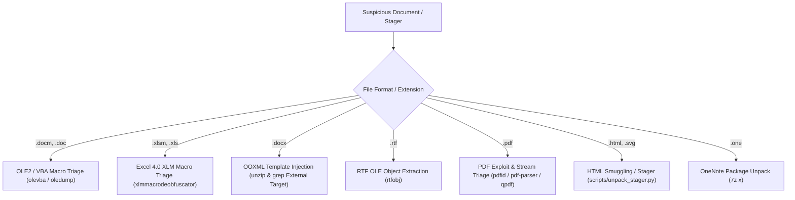

# Malicious Document & Phishing Stager Triage Reference

Static, non-executing triage of suspicious Microsoft Office documents, HTML smuggling attachments, Windows shortcuts (.lnk), OneNote packages, and PDFs to extract malicious macros, formulas, templates, embedded payloads, and IOCs.

---

## 1. Programs & Toolchain Used

| Program / Tool | Role / Purpose |
| :--- | :--- |
| **`scripts/unpack_stager.py`** | Bundled Python script to peel nested Base64 blobs, detect embedded PEs, and defang URLs |
| **`oletools`** (`oleid`, `olevba`, `rtfobj`) | VBA macro scanning, OLE stream decoding, and RTF exploit parsing |
| **`oledump.py`** | OLE2 stream decomposition and plugin-based heuristic payload extraction |
| **`xlmmacrodeobfuscator`** | Emulation and formula deobfuscation for Excel 4.0 (XLM) macros |
| **`pdfid.py` & `pdf-parser.py`** | PDF name table scanning, stream decompression, and JavaScript extraction |
| **`qpdf`** | Content-preserving PDF structure decompression and decryption |
| **`msoffcrypto-tool`** | Decrypting password-protected Office files using default/known keys (`VelvetSweatshop`) |
| **`7-Zip` (`7z`)** | Unpacking OneNote (`.one`) packages, ISO containers, and OOXML ZIP archives |

---

## 2. Safety & Negative Guardrails

| Hallucination / Mistake | Why It Fails | Correct Protocol / Syntax |
| :--- | :--- | :--- |
| Opening file in Office / Reader | Triggers active exploits, macro payloads, or network beaconing | **NEVER open in native applications.** Inspect strictly with static parsers |
| Running extracted VBS / JS / HTA | Executes malicious script stagers on host | Inspect script contents statically via text tools (`sed`, `grep`, `jq`) |
| Executing dropped PE / DLL | Compromises local workstation | Dissect dropped files with `pe-malware-triage` (diec/capa/floss) |
| Assuming `.docx` has no macros | Attackers use external template injection in `_rels/` | Unpack and inspect `word/_rels/settings.xml.rels` for external URLs |

---

## 3. Document Format & Triage Routing Matrix



| Extension | Vector / Threat Type | Parser Sequence | Key Detection Signal |
| :--- | :--- | :--- | :--- |
| **`.docm`, `.doc`** | VBA Macro / Dropper | `oleid` &rarr; `olevba --decode` &rarr; `oledump.py` | AutoExec triggers (`Document_Open`, `AutoOpen`), shell execution. |
| **`.xlsm`, `.xls`** | Excel 4.0 (XLM) Macro | `olevba` &rarr; `xlmmacrodeobfuscator` | Hidden sheets, `EXEC()`, `URLDOWNLOADTOFILE()`, `CALL()`. |
| **`.docx`** | Template Injection | `unzip` &rarr; `grep "TargetMode=\"External\""` | Remote template references fetching `.dotm` stagers. |
| **`.rtf`** | Equation Editor Exploit | `rtfobj -s all -d ./out/` | Embedded OLE objects (`Equation.3`, CVE-2017-11882). |
| **`.pdf`** | JS / Launch Actions | `pdfid.py -e` &rarr; `pdf-parser.py` | `/JavaScript`, `/Launch`, `/EmbeddedFiles`, `/OpenAction`. |
| **`.html`, `.svg`**| HTML Smuggling | `python scripts/unpack_stager.py` | Base64 blob downloads (`URL.createObjectURL`, `msSaveOrOpenBlob`). |
| **`.one`** | OneNote Attachment | `7z x suspect.one -o./out/` | Embedded batch scripts (`.bat`, `.cmd`, `.vbs`, `.hta`, `.exe`). |

---

## 4. High-Leverage Composite Triage Examples

```bash
# 1. Word VBA macro & embedded stream triage
oleid suspect.docm
olevba --decode --reveal suspect.docm > extracted_vba.vba
python oledump.py -p plugin_embeddedfile -d suspect.doc > dropped_payload.bin

# 2. Excel 4.0 (XLM) formula deobfuscation
xlmmacrodeobfuscator -f suspect.xlsm --export-formulas

# 3. PDF structural decompression and JavaScript object extraction
python pdfid.py -e suspect.pdf
python pdf-parser.py --search javascript suspect.pdf
qpdf --qdf --decrypt suspect.pdf decompressed.pdf

# 4. Windows Shortcut (.lnk) IOC extraction
strings -a -e l suspect.lnk | grep -E -i "(powershell|cmd\.exe|http|certutil|mshta|bitsadmin)"
```
