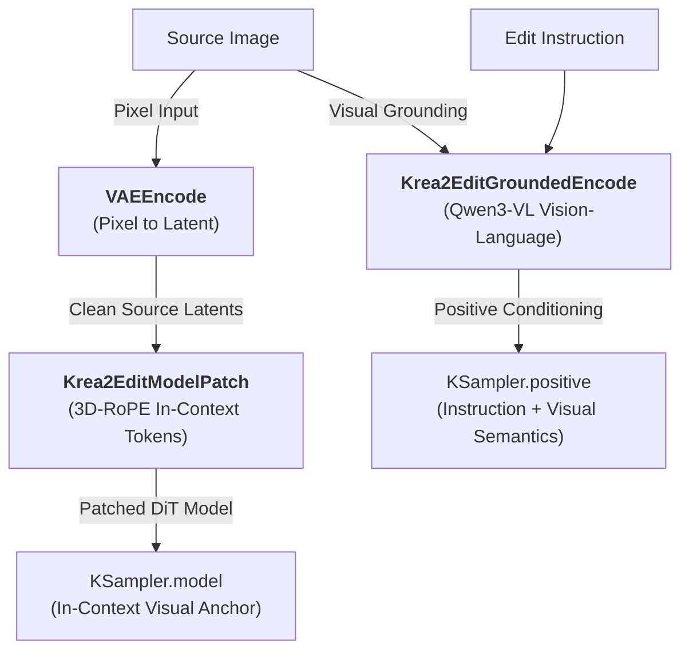

[← Back to Universal Prompt Builder Hub](SKILL.md) | [Go to Krea 2 Generation Playbook →](krea2.md)

# ComfyUI-Krea2Edit & Identity-Preserving Image Editing Playbook

This playbook provides a complete technical guide to instruction-based image editing, identity-preserving character restaging, attribute modification, object removal, and two-reference scene composition using **`comfyui-krea2edit`** (by `lbouaraba` / `conradlocke`) and the **Krea 2 Identity Edit LoRA** (`krea2_identity_edit_v1_2.safetensors`).

---

## 1. Technical Architecture & Dual Conditioning Pipeline

`comfyui-krea2edit` turns Krea 2 (RAW or Turbo) into an instruction-based editor using **Dual In-Context Conditioning**, matching the exact training geometry of the `krea2edit-trainer`:



### A. Appearance Path: In-Context DiT Patching & 3D RoPE Positioning
`Krea2EditModelPatch` intercepts Krea 2's `SingleStreamDiT` forward pass, concatenating clean source latents into the sequence via 3D Rotary Position Embeddings (3D-RoPE):
* **Frame Index Allocations:**
  * **Text tokens:** Frame $(0, 0, 0)$.
  * **Source Reference 1 (Scene / Primary):** Frame **1** $(1, y, x)$.
  * **Source Reference 2 (Subject / Person):** Frame **2** $(2, y, x)$.
  * **Target Latent:** Frame **0** $(0, y, x)$.
* **`fit` Mode Geometry (v1.2+ Fractional Centering):** Resamples source images onto the exact $/16$ latent patch grid, eliminating coordinate skip and seam artifacts when source and target aspect ratios differ.
* **Reference Attention Fidelity Dial (`ref_boost`):**
  * **`ref_boost: 4.0`** (recommended for subject reference) strongly locks facial identity and fine features.
  * **`ref_boost: 0.9`** loosens self-attention anchor to allow seamless object removal.
  * `ref_boost_mask`: Restricts the attention boost specifically to a masked face or garment.

### B. Semantic Grounding Path: Qwen3-VL Vision-Language Encoding
`Krea2EditGroundedEncode` feeds the instruction prompt and the downscaled source image(s) into **Qwen3-VL (4B)**:
* **`grounding_px` Quality Dial (default `768`):**
  * **`1024`**: Maximizes facial identity and fine likeness retention (optimal for portraits).
  * **`512`**: Loosens grounding for stubborn, heavy environment/background replacements.

### C. Pixel Path & VRAM Pre-Encoding (`target_latent`)
* When using `vae` + `source_image`, wire `target_latent` (the empty latent feeding `KSampler.latent_image`) to prime the resolution cache and prevent offloading model weights to CPU during sampling.

---

## 2. Model Selection, CFG & Sampling Matrix

| Edit Operation | Engine Base | Steps | CFG Scale | Sampler | Mechanical Rules & Wiring |
|---|---|---|---|---|---|
| **1. Attribute / Garment / Recolor / Restyle** | K2 Turbo | 8–12 | **CFG 1.0** | `euler` (simple) | Fast path (~1 min at 2MP). Empty prompt negative (inert at CFG 1.0). |
| **2. Salient Object / Subject Deletion** | **K2 RAW** | **20–25** | **CFG 3.0** | `euler` (simple) | **CRITICAL:** Turbo at CFG 1 re-renders subject! Must use RAW at CFG 3.0 with grounded empty negative (`""`). |
| **3. Two-Input Composition (Person into Scene)** | K2 RAW or Turbo | 12–25 | CFG 1.0–3.0 | `euler` (simple) | Place both references simultaneously (Scene $\rightarrow$ main inputs, Person $\rightarrow$ `_b` inputs). |
| **4. Environment / Lighting Restage & Relight** | **K2 RAW** | **22–28** | **CFG 2.5** | `euler` (simple) | Replaces entire backdrop and restyles ambient light while preserving character posture and identity. |

> ⚠️ **Sampler Warning:** Always use **`euler` (ODE)** with the `simple` scheduler at **denoise `1.0`**. Avoid SDE samplers like `er_sde`, which degrade reference coherence in edit pipelines.

---

## 3. Strict Prompting & Formatting Syntax for Krea2Edit & Ostris Edit

### 1. ComfyUI Node Architecture Comparison: Krea2Edit vs. Ostris Edit

| Feature / Dial | `comfyui-krea2edit` (`lbouaraba`) | `ComfyUI-Krea2-Ostris-Edit` (`ostris`) |
|---|---|---|
| **Core Nodes** | `Krea2EditModelPatch` + `Krea2EditGroundedEncode` | `Krea 2 Ostris Edit Model Patch` + `Text Encode Krea 2 Ostris Edit` |
| **LoRA Architecture** | `krea2_identity_edit_v1_2.safetensors` (trained with `krea2edit-trainer`) | AI-Toolkit Krea 2 Edit LoRAs (`edit: true`) |
| **Reference Image Slots** | Up to 2 inputs: `image` (Scene/Frame 1) & `image_b` (Person/Frame 2) | Up to 3 inputs: `image1`, `image2`, `image3` |
| **Grounding Resolution** | `grounding_px`: 384–1024 (Quality dial; 1024 for faces) | Fixed 384x384 downsampling for text encoder |
| **Fidelity Dial** | `ref_boost` (e.g. `4.0` for subject face lock) | Governed by LoRA weight (@1.0) and CFG scale |
| **Prompt Reference Syntax** | `"the subject"`, `"image A"` / `"image B"` or `"Image 1"` / `"Image 2"` | `image1`, `image2`, `image3` (e.g., `"Replace the shirt in image1 with the jacket in image2"`) |

---

### 2. Instruction-Based Natural Language Syntax
Both node packs are trained on direct, active transformation orders rather than static text-to-image descriptions. Always specify **what to change, what to preserve, and the optical result**:

$$\text{Edit Prompt} = [\text{Target Action Verb}] + [\text{Specific Subject/Region Anchor}] + [\text{New Tactile/Physical Property}] + [\text{Lighting \& Optics Consistency}]$$

* ❌ **WRONG (Generative Prompt):** `"a photo of a man in a red jacket standing in a modern kitchen"`
* ✅ **RIGHT (Instruction Prompt):** `"Change the man's charcoal wool overcoat into a dark crimson corduroy jacket with visible ribbing and horn buttons. Preserve his facial expression, hair, and the 2700K tungsten workshop lighting."`

---

### 3. Image Reference Syntax Rules (`Image1` vs. `Image2`)
* **1-Based Indexing Only:** Always use `Image 1`, `Image 2`, `Image 3` or `Image A`, `Image B`. Never use `Image0` (which is unrecognized by VLM token parsers).
* **Slot-to-Concept Binding:** When using multiple references, explicitly assign the visual roles:
  * *Two-Image Composition (Person + Scene):* `"Place the subject from image2 into the library scene from image1..."`
  * *Texture/Outfit Transfer:* `"Replace the jacket on the person in image1 with the leather jacket from image2. Preserve the facial identity and lighting from image1."`
* **Negative Reference Disambiguation:** When pulling a subject from a reference image, explicitly instruct the model to ignore that image's background:
  * `"Extract only the character from image2; do not retain the background or lighting from image2."`

---

### 4. Resolution & Spatial Rules
* **Generate at $\le 2\text{MP}$:** Recommended resolutions: $1024 \times 1024$ (1:1), $832 \times 1216$ (4:5 vertical), $1216 \times 832$ (16:9 widescreen). Keep multi-person compositions $\le 1.5\text{MP}$.
* **Spatial Disambiguation:** Use clear positional anchors (`"the coffee cup in his right hand"`, `"the background wall behind the left shoulder"`).

---

## 4. Production-Ready Examples

### Example 1: Precision Wardrobe & Tactile Fabric Swap (K2 Turbo Fast Path)

**📝 Edit Instruction Prompt**
```text
Swap the casual cotton jacket on the 35-year-old man in reference image1 for a structured charcoal herringbone tweed overcoat with notched lapels and horn buttons. Preserve his facial bone structure, hairstyle, and posture. Seamlessly integrate heavy wool drape, tactile woven texture, and matching 3200K golden hour directional rim lighting casting realistic contact shadows across the chest.
```

**🚫 Negative Prompt**
```text
(Leave blank — negative conditioning is bypassed at CFG 1.0 on Krea 2 Turbo fast path)
```

**🎛 Model & Node Parameters**
| Parameter | Setting | Rationale |
| :--- | :--- | :--- |
| **Target Engine** | **Krea 2 Turbo** + `krea2_identity_edit_v1_2` LoRA (@1.0) | High-speed distilled transformer path optimized for single-pass garment replacement with identity preservation. |
| **Sampler / Steps / CFG** | `euler` (simple) / **10–12 steps** / **CFG 1.0** | Prevents over-sharpening artifacts while maintaining fast inference latency (~1 min). |
| **Node Dials** | `fit_mode: fit`<br>`grounding_px: 1024`<br>`ref_boost: 4.0` | `fit_mode: fit` aligns latents to the $/16$ grid; `1024px` grounding maximizes facial detail; `ref_boost: 4.0` strongly anchors facial identity. |
| **Resolution / Aspect Ratio** | Match Source Aspect Ratio (e.g., `4:5` / `832 × 1216` or `1:1` / `1024 × 1024`) | Native 1-megapixel bucket dimensions eliminate coordinate drift and seam artifacts. |
| **Slot Binding** | Frame 1: `image1` (Source Portrait) | 3D-RoPE in-context patch binding with Qwen3-VL semantic encoding. |

**🔄 Actionable Iteration Directives**
1. **Textile / Fabric Variation:** Swap the charcoal herringbone tweed for a heavyweight camel hair overcoat with a velvet topcollar and tortoiseshell buttons.
2. **Accessory & Layering Addition:** Add a burgundy ribbed cashmere scarf draped neatly beneath the coat lapels, tucked across the chest.
3. **Lighting Temperature & Angle Shift:** Shift directional lighting from 3200K golden hour to crisp 5500K overcast daylight with soft, diffuse fill across the tweed texture.
4. **Collar & Silhouette Adjustment:** Pop the tweed overcoat collar upward around the neck against a gentle gust of wind, creating dynamic angular tension along the lapels.

---

### Example 2: Salient Object Removal & Seamless Inpainting (K2 RAW Guided Path)

**📝 Edit Instruction Prompt**
```text
Completely remove the modern red automobile parked in the foreground of the antique European square in reference image1. In its place, seamlessly inpaint continuous weathered cobblestone pavement, authentic masonry mortar joints, and rustic stone patina matching the surrounding plaza. Cast accurate 2700K street lantern illumination with soft-edged contact shadows across the restored pavers.
```

**🚫 Negative Prompt**
```text
(Leave empty string "" — passed through a secondary Krea2EditGroundedEncode node with image1 to establish the unconditional baseline for CFG subtraction)
```

**🎛 Model & Node Parameters**
| Parameter | Setting / Selection | Rationale & Mechanical Function |
| :--- | :--- | :--- |
| **Target Engine** | **Krea 2 RAW** + `krea2_identity_edit_v1_2` LoRA (@1.0) | True flow-matching base allows genuine classifier-free guidance (CFG) necessary to cleanly erase salient structures without ghosting or re-rendering artifacts. |
| **Sampler / Steps / CFG** | `euler` (simple scheduler) / **22–25 steps** / **CFG 3.0** | Sufficient step density to resolve intricate mortar joints and weathered stone grain. CFG 3.0 provides robust semantic guidance to overwrite foreground latents. |
| **Node Dials (`comfyui-krea2edit`)** | `fit_mode: fit`<br>`grounding_px: 1024`<br>`ref_boost: 0.9` | • `fit`: Aligns to the $/16$ latent patch grid without coordinate seam distortion.<br>• `grounding_px: 1024`: High-resolution visual grounding retains fine architectural masonry context.<br>• `ref_boost: 0.9`: Loosens the self-attention memory anchor just enough to allow full object erasure. |
| **Conditioning Architecture** | Dual In-Context 3D-RoPE + Qwen3-VL | Ingests `reference image1` as Frame 1 latent anchor while Qwen3-VL encodes the spatial instruction to guide regional latent inpainting. |
| **Aspect Ratio & Resolution** | Source Native (`3:2` / `1248×832` or `4:3` / `1216×896`) | Match source image bucketed 1MP resolution directly to preserve native perspective geometry. |

**🔄 Actionable Iteration Directives**
1. **Historical Period Prop Insertion:** In place of the removed automobile, place a weathered wrought-iron bench with carved wooden slats and a parked vintage bicycle leaning against the curb.
2. **Atmospheric & Wetness Shift:** Add glistening rain reflections across the inpainted cobblestones, catching direct 2700K amber specular highlights from the street lantern with dark specular puddles.
3. **Lighting & Shadow Angle Tuning:** Lengthen the 2700K tungsten contact shadows diagonally across the newly exposed plaza pavers to simulate a low-angled architectural street lantern beam.
4. **Foliage & Debris Grounding:** Scatter fallen dry autumn leaves and fine gravel into the recessed mortar lines between the newly inpainted cobblestones for added organic textural integration.

---

### Example 3: Multi-Reference Character-into-Scene Composition (Dual-Image / Ostris & Krea2Edit)

**📝 Edit Instruction Prompt**
```text
Place the 26-year-old cybernetic specialist from reference image2 onto the elevated walkway of reference image1. Extract only the subject from image2, preserving her 26-year-old facial bone structure and dark tactical jacket. She stands in the midground overlooking the rainy night market. Relight with image1's 4000K ambient rain reflections and vibrant cyan neon, matching the f/2.0 optical depth of field.
```

**🚫 Negative Prompt**
```text
(Empty prompt via second Krea2EditGroundedEncode node with both image1 and image2 connected)
```

**🎛 Model & Node Parameters**
| Parameter | Setting | Rationale |
| :--- | :--- | :--- |
| **Target Engine** | **Krea 2 RAW + `krea2_identity_edit_v1_2` LoRA (@1.0)** | Dual In-Context 3D-RoPE conditioning with classifier-free guidance for seamless cross-image illumination synthesis. |
| **Slot Wiring** | `image1` (Scene) $\rightarrow$ `image` / `source_latent`<br>`image2` (Subject) $\rightarrow$ `image_b` / `source_latent_b` | Binds the neon night market to Frame 1 and the cybernetic specialist to Frame 2 in 3D-RoPE latent space. |
| **Aspect Ratio & Res** | **`16:9` (`1216 × 832` or `1344 × 768`)** | Matches native 1-megapixel DiT bucket dimensions of the background scene without coordinate distortion. |
| **Sampler / Steps / CFG** | **`euler` (simple) / 22 steps / CFG 2.5** | ODE trajectory with denoise `1.0`; CFG 2.5 provides optimal guidance to integrate wet surface specular highlights without latent burning. |
| **Node Dials** | `fit_mode: fit`<br>`grounding_px: 1024`<br>`ref_boost: 4.0` (Subject / `image2`)<br>`ref_boost_a: 1.0` (Scene / `image1`) | 1024px grounding and 4.0 attention boost ensure strict facial identity and tactical jacket texture preservation. |
| **Negative Conditioning** | Second `Krea2EditGroundedEncode` with **`""` (empty string)** and both references | Provides the unguided visual baseline for CFG subtraction. |

**🔄 Actionable Iteration Directives**
1. **Pose & Tactile Interaction Shift:** Instruct the specialist to lean both forearms against the wet metal walkway railing, resting her chin slightly as water droplets bead along the sleeves of her tactical jacket.
2. **Atmospheric & Rain Shift:** Increase dense downpour streaks illuminated by passing overhead holographic market signs, adding raking specular streaks across the wet walkway grating.
3. **Cybernetic & Hardware Accent Shift:** Relight her ocular cybernetic implant with an active 8000K electric blue diagnostic pulse, casting subtle contact rim light along her right cheekbone and temple.
4. **Optics & Focal Plane Shift:** Tighten the aperture to $f/1.4$ for creamy circular bokeh across background vendor canopies while keeping the subject's 26-year-old facial bone structure in tack-sharp focus.

---

### Example 4: Environmental Restyling & Complex Relighting (Overcast Park to Sunset Cabin Veranda)

**📝 Edit Instruction Prompt**
```text
Restyle the environment in image1 from an overcast park into a rustic timber cabin veranda overlooking distant mountain bokeh at sunset. Strictly preserve the 42-year-old reading subject's facial bone structure, spectacles, and seated posture. Relight the scene with low-angle 2600K sunset sidelight, casting warm amber highlights across the subject's face, glasses frames, and timber veranda railing.
```

**🚫 Negative Prompt**
```text
(Empty prompt — wire a second Krea2EditGroundedEncode node with an empty string `""` and reference image1 connected)
```

**🎛 Model & Node Parameters**
| Parameter | Setting | Rationale |
| :--- | :--- | :--- |
| **Target Engine & LoRA** | **Krea 2 RAW** + `krea2_identity_edit_v1_2.safetensors` (@1.0) | Krea 2 RAW provides full CFG trajectory control necessary for complete background replacement and physical relighting. |
| **Pipeline Architecture** | `comfyui-krea2edit` (`Krea2EditModelPatch` + `Krea2EditGroundedEncode`) | Dual In-Context 3D-RoPE conditioning (Frame 1 source latent concatenation + Qwen3-VL grounded guidance). |
| **Aspect Ratio & Resolution** | Source Aspect Ratio (e.g., `4:5` / `896 × 1152` or `16:9` / `1344 × 768`) | Native 1-megapixel bucket matching input image dimensions to prevent latent stretching. |
| **Sampler & Scheduler** | **`euler` (simple ODE)** | Deterministic ODE solver; avoids stochastic drift and preserves identity coherence. |
| **Sampling Steps** | **24 steps** | Optimal step density to resolve new timber grain and mountain bokeh while locking facial features. |
| **CFG Scale** | **CFG 2.5** | Balanced guidance to fully overwrite background park pixels without blowing out 2600K specular highlights. |
| **Node Dials** | `fit_mode: fit`<br>`grounding_px: 768`<br>`ref_boost: 3.5` | Fractional latent centering; `grounding_px: 768` enables deep environmental transformation; `ref_boost: 3.5` firmly binds facial geometry and spectacles. |

**🔄 Actionable Iteration Directives**
1. **Atmospheric Depth & Mountain Fog Shift:** Introduce low-lying 5500K blue-hour valley mist settling between pine trees in the distant mountain background to amplify complementary two-tone color contrast against the 2600K warm cabin veranda.
2. **Prop & Veranda Surface Restyling:** Add a steaming ceramic mug of coffee resting on the weathered timber handrail beside the reader, catching directional sunset rim light with fine steam wisps.
3. **Lighting Angle & Sidelight Intensity Shift:** Lower the 2600K sun angle by 10° to rake longer amber cast shadows across the timber plank floor and produce a subtle golden flare across the corner of the spectacles.
4. **Kinetic Action & Page-Turn Dynamic:** Capture the subject's right fingertips in mid-action turning the parchment page of the book, introducing natural paper flex tension while preserving the relaxed seated reading posture.


