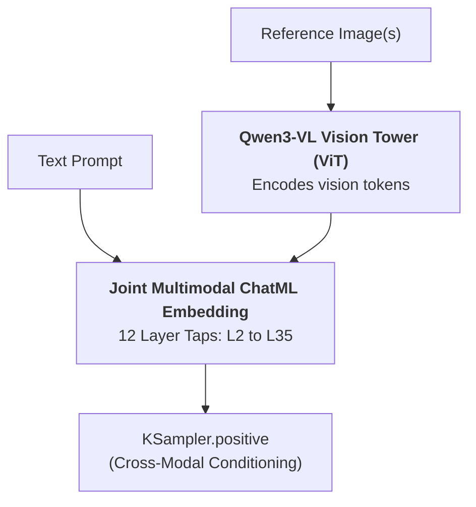

[← Back to Universal Prompt Builder Hub](SKILL.md) | [Go to Krea 2 Edit & Inpainting Playbook →](krea2-edit.md)

# Krea 2 (K2) Advanced Prompting & Optical Steering Playbook

Krea 2 is a **Single-Stream MMDiT (Diffusion Transformer) with Rectified Flow-Matching (RF-DiT)** conditioned on a **Qwen3-VL** multimodal text encoder. It utilizes cross-layer feature aggregation (`txtfusion`) to blend 12 discrete hidden layers `[L2, L5, L8, L11, L14, L17, L20, L23, L26, L29, L32, L35]` coarse-to-fine.

---

## 1. Technical Architecture & Text Encoder Mechanics

### 4 Functional Layer Bands in Krea 2
Ground-truth layer analysis reveals that the 12 tapped hidden layers form **4 functional bands of 3 layers each ($3 \times 4$)**:

| Band | Layers / Taps | Functional Role |
|---|---|---|
| **Band 1: Shallow Scaffolding** | `L2, L5, L8` (`w0–w2`) | Lexical anchoring & token noise (unusable alone; renders as noise). |
| **Band 2: Structure & Layout** | `L11, L14, L17` (`w3–w5`) | Structural geometry, vanishing points, scene layout, and glyphs (`L14`). |
| **Band 3: Global Attention Hub** | `L20, L23, L26` (`w6–w8`) | Volumetric lighting, color transitions; `L20` is universal attention hub. |
| **Band 4: Deep Content & FACS** | `L29, L32, L35` (`w9–w11`) | Carries semantic detail: FACS micro-expressions, irises, and skin pores. |

> **Why Rebalancing Works:** Krea 2's learned `txtfusion.projector` is contrastive ("mid-minus-deep"), which naturally suppresses deep layers `L23–L32` to balance encoder norm growth ($48\times$). Rebalancing with RMS normalization re-inflates the deep Band 4 layers, restoring facial expression nuance and skin micro-pores without image degradation.

---

## 2. Model Variants & Parameter Matrix

| Variant | Step Range | CFG Scale | Primary Characteristics |
|---|---|---|---|
| **1. Krea 2 RAW** | 25–40 steps | CFG 3.0–5.0 | Maximum fidelity, rich micro-textures, full dynamic range and lighting nuance. |
| **2. Krea 2 Turbo** | 8–12 steps | CFG 1.0 | Distilled ultra-fast flow-matching. Negative prompts are inert. |

### 🚫 Negative Prompt Policy & Natural Language Steering
- **Never use traditional negative prompt fields on Krea 2.**
- **Natural Language Steering (Qwen3-VL):** Because Krea 2 uses a multimodal VLM text encoder, it parses instructions as full natural language sentences rather than SD1.5-style bag-of-words token weights.
- **Negative Weights (NegPiP):** Syntax like `(word:-2.0)` is only active if an attention-inversion custom node (like `ComfyUI-krea2-negpip`) is installed. In standard native Krea 2, **use direct natural language phrasing** to suppress concepts (e.g. *"bare face without glasses"*, *"wide environmental framing showing the full body"*).
- **Positive Emphasis Band:** In standard nodes, keep emphasis weights moderate (between `1.1` and `1.5`, e.g. `(cinematic lighting:1.2)`). Excessive weights cause color burn and pixel degradation.

---

## 3. Strict Prompting & Formatting Syntax Rules

### The 8-Block Canonical Prompt Sequence
To maximize Qwen3-VL token-attention efficiency, structure all natural language prompts in this exact 8-block sequence:

```
[1. LENS & SHOT GEOMETRY] ──► [2. LIGHTING & ATMOSPHERE] ──► [3. SUBJECT ANCHOR] ──► [4. ENVIRONMENT & SURFACES]
                                                                                             │
[8. COLOR & FILM GRAIN]   ◄── [7. BIOMECHANICAL POSE]    ◄── [6. SECONDARY MOTION] ◄── [5. FACS MICRO-EXPRESSION]
```

1. **Lens & Shot Geometry:** Focal length, aperture, angle, framing (*"85mm f/1.4 portrait prime lens, eye-level framing"*).
2. **Lighting Physics in Kelvin:** Key light, fill, shadow falloff (*"2700K warm tungsten reading lamp casting high-contrast chiaroscuro"*).
3. **Subject Anchor & Wardrobe:** Tangible textures (*"weary intelligence officer in a structured charcoal woolen coat"*).
4. **Environment & Surface Textures:** Physical boundaries (*"dimly lit vintage train carriage interior with mahogany paneling"*).
5. **FACS Micro-Expressions:** Muscle and ocular mechanics (*"head tilted 10° down, lower eyelids tightened in suspicion (AU7)"*).
6. **Secondary Physics:** Hair and cloth aerodynamics (*"loose strands of copper hair resting across her temple"*).
7. **Biomechanical Pose & Tactile Grip:** Asymmetry and weight (*"seated contrapposto, resting chin upon curled knuckles"*). Knuckles belong to hands/fingers; soles, heels, and arches belong to feet.
8. **Color Grading & Film Stock:** Grain and palette (*"35mm film still with unretouched skin micro-pores"*).

> 💡 **Signage vs. Kelvin Disambiguation:** When prompting neon signs or storefronts, describe the light temperature separately from the sign (e.g. write *"warm amber neon signage casting 3000K illumination across the scene"* rather than *"a 3000K neon sign"*) to prevent diffusion text encoders from rendering numeric numbers like `"3000K"` as literal text on the sign.

---

## 4. Emotional Context & FACS Micro-Facial Guidance in Krea 2

Because Krea 2 uses a multimodal **Qwen3-VL** encoder, it responds directly to natural language descriptions of physical muscle tensions and **FACS Action Units** without needing booru tags.
- For universal FACS muscle mechanics, catchlight rules, and anti-plasticity dermal anchors (micro-pores, goosebumps, skin folds), see [**`SKILL.md` §2.E**](SKILL.md#e-facs-facial-mechanics--anti-plasticity-dermal-topography).

### Krea 2 Specific Hardware & Encoder Rules:
* **Encoder Rebalancing for Facial Nuance & Pores:** To maximize pore and expression fidelity in diffusion nodes, use the **Portrait & Micro-Emotion KGW preset** (boosting Band 4: `w9–w11`). The default learned projector suppresses deep layers `L23–L32`; rebalancing re-inflates these layers to capture high-frequency facial micro-geometry.

---

## 5. Kinetic Posing, Tactile Actions & Optical Staging in Krea 2

Krea 2 excels at continuous natural language prose describing spatial relationships, weight transfer, and camera perspectives without stiff mannequin artifacts.
- For the universal 3-plane optical depth staging framework, camera angle matrix, DoF guidelines, contrapposto rules, and tactile blueprints, see [**`SKILL.md` §2**](SKILL.md#2-core-physical-pillars--optical-staging).

### Krea 2 Specific Staging Schema:
* **The "Core Four" Biomechanical Flow:** When constructing Block 7 of Krea 2's 8-block canonical sequence, weave together:
  1. `silhouette` (*broad asymmetric triangular silhouette*)
  2. `weight_distribution` (*80% bodyweight planted on right heel in deep contrapposto*)
  3. `torso_orientation` (*hips angled 45° camera-left with shoulders twisted back toward lens*)
  4. `movement_quality` (*secondary coat and hair billowing*)
* **Layer Boost for Complex Anatomy:** When generating extreme acrobatic poses, dynamic perspective foreshortening, or complex hand grips, use the **Kinetic Pose & Anatomy Lock KGW preset** (boosting Bands 1 & 2: `w0–w5`).

---

## 6. Native Multimodal Image Prompting (Qwen3-VL Vision Tower)

Unlike legacy diffusion architectures where the text encoder only processes strings of text tokens, **Krea 2 natively supports image prompting directly inside the CLIP/Text conditioning pipeline** via its integrated **Qwen3-VL-4B** vision-language encoder (`type: krea2`).



### The Native Multi-Image Template & `Picture N:` Syntax
In Krea 2's native conditioning template, reference images are ingested as structured vision blocks:
```text
<|im_start|>system
Describe the image by detailing the color, shape, size, texture, quantity, text, spatial relationships of the objects and background:<|im_end|>
<|im_start|>user
Picture 1: <|vision_start|><|image_pad|><|vision_end|>
Picture 2: <|vision_start|><|image_pad|><|vision_end|>
{prompt}<|im_end|>
<|im_start|>assistant
```
When prompting with multiple images, **explicitly refer to `Picture 1` and `Picture 2` in your prompt** for exact 1:1 cross-modal token binding (e.g. *"The person in Picture 1 wears the armor from Picture 2 inside a rain-soaked forest"*).

---

### The 4 Core Modes of Native Image Prompting

#### Mode A: Style, Lighting & Medium Reference (SREF)
Transfers color palette, Kelvin lighting ratios, lens optics, and rendering medium from the reference image without cloning the original subject:
```text
In the exact visual style, 2700K tungsten chiaroscuro lighting, and 35mm film grain of Picture 1: a vintage automobile mechanic in a canvas jumpsuit leans over an open engine bay, holding a steel wrench.
```

#### Mode B: Character & Facial Likeness Lock (CREF)
Preserves facial bone structure, eye shape, and identity from the reference image while restaging the subject into completely new poses, wardrobe, and environments:
```text
Subject is the exact person from Picture 1, preserving facial bone structure, dark eyes, and jawline. The subject wears an orange alpine storm suit and climbing harness, leaning into a dynamic sprint across snow.
```

#### Mode C: Compositional & Spatial Staging Mimicry
Adopts the exact framing geometry, Dutch tilt angle, and 3-plane depth separation of the reference image while populating new subjects:
```text
Matching the low-angle upward camera angle, high-speed shutter freeze, and 3-plane optical depth staging of Picture 1: an eagle takes flight from a mountain ledge.
```

#### Mode D: Multi-Angle Character Sheet Reference (360° Volumetric Lock)
Passes a **character turnaround / model sheet** (displaying front, 3/4, profile, back views, and expression close-ups on a neutral background) as `Picture 1`. This primes Qwen3-VL with 360-degree volumetric understanding of the character's bone structure, hairstyle volume, and costume details from any angle:
* **The Anti-Collage Prompting Rule:** Because the reference image is a multi-panel grid, naive prompts risk generating another multi-panel turnaround. You **must explicitly command a single unified scene** via natural language:
```text
Picture 1 is a character turnaround reference sheet. Render a single unified cinematic composition depicting this exact character in a dynamic seated contrapposto pose inside a dimly lit vintage library. The character holds an open leather-bound book with right hand, gazing 15 degrees off-camera in quiet contemplation (AU1+AU2). 2700K warm brass lamp key light with 7500K window shadow fill. 85mm f/1.4 lens with shallow depth of field. Style: 35mm film still with visible skin micro-pores. Do not render a turnaround, model sheet, split panel, or multiple views.
```

---

### Core Operational Rules for Image Prompting

1. **Resolution Sizing (`grounding_px`):**
   * **`1024px`** for facial likeness & character sheets (CREF / Mode B & D).
   * **`512px`** for broad style & color palette transfer (SREF / Mode A).
2. **Preventing Visual Bleed (Explicit Unbinding):**
   * If a reference image contains something you want changed (e.g. glasses or clothing color), explicitly state the replacement (e.g. *"render bare face without glasses"*).
3. **The Anti-Collage Rule (for Character Sheets):**
   * When passing multi-panel turnaround sheets, explicitly state:  
     *"Render a single unified composition. Do not render a turnaround, model sheet, split panel, or multiple views."*
4. **Canvas Limit with Image Prompts:**
   * Keep generations $\le 2\text{MP}$ ($1024 \times 1024$, $832 \times 1216$) to prevent subject duplication.

---

## 7. KGW Rebalance Presets (ComfyUI / Diffusion Nodes)

### The 5 Core Presets (Code-Verified)

#### 1. ⚖️ Balanced (Universal Production Default)
* **Best For:** General all-purpose production across photo, illustration, and diverse concepts without likeness drift.
* **Multiplier:** `1.0` (with RMS Renormalize: `True`)
* **Layer Vector:** `1.0, 1.0, 1.0, 1.0, 1.0, 1.0, 1.0, 2.5, 5.0, 1.1, 4.0, 1.0`

#### 2. 👤 Portrait & Micro-Emotion
* **Best For:** Close-up character portraits, facial FACS Action Units, corneal catchlights, iris texture, and skin micro-pores (boosts Band 4: `w9–w11`).
* **Multiplier:** `1.0` (with RMS Renormalize: `True`)
* **Layer Vector:** `1.8, 1.8, 1.8, 1.8, 2.0, 2.0, 2.5, 4.5, 1.2, 3.5, 1.0, 1.0`

#### 3. 🏋️ Kinetic Pose & Anatomy Lock
* **Best For:** Complex multi-limb poses, acrobatic actions, hand interactions, and perspective geometry (boosts Bands 1 & 2: `w0–w5`).
* **Multiplier:** `1.0` (with RMS Renormalize: `True`)
* **Layer Vector:** `2.5, 2.5, 2.5, 2.5, 1.5, 1.5, 1.5, 1.5, 1.0, 1.0, 1.0, 1.0`

#### 4. 🎬 Cinematic Lighting & Atmosphere
* **Best For:** Volumetric light shafts, dramatic chiaroscuro, neon night scenes, anamorphic flares, and color grading (boosts Band 3: `w6–w8`).
* **Multiplier:** `1.0` (with RMS Renormalize: `True`)
* **Layer Vector:** `1.0, 1.0, 1.0, 1.0, 2.5, 3.5, 4.0, 4.0, 3.5, 4.5, 5.0, 4.0`

#### 5. ⚡ Dual-Anchor Hybrid (Action + Emotion)
* **Best For:** High-intensity scenes demanding simultaneous complex kinetic action/poses AND deep micro-facial emotion (combines Bands 1/2 with Band 4).
* **Multiplier:** `1.0` (with RMS Renormalize: `True`)
* **Layer Vector:** `2.4, 2.4, 2.2, 2.0, 1.6, 1.8, 2.2, 3.8, 1.4, 3.8, 1.2, 1.0`

---

## 8. Production-Ready Examples

### Example 1: Master Watchmaker (Tactile Craft & Micro-Assembly)
* **Configuration:** Krea 2 RAW | **Aspect Ratio:** `4:5` (Vertical Portrait) | **Preset:** 👤 Portrait & Micro-Emotion
* **per_layer_weights:** `1.8, 1.8, 1.8, 1.8, 2.0, 2.0, 2.5, 4.5, 1.2, 3.5, 1.0, 1.0` (Multiplier: `1.0`, RMS Renormalize: `True`)

**📝 Primary Positive Prompt:**
```text
85mm f/1.8 macro lens, shallow depth of field. A 2700K tungsten task lamp illuminates the workbench against cool 6000K shadow fill. A 68-year-old master watchmaker wearing a canvas apron and brass monocle loupe leans forward over an antique escapement gear. Pinched brow and taut lower eyelids focus with an iris catchlight. His thumb and forefinger apply downward tactile grip pressure on micro-tweezers, seating the gear against ruby bearings. Kodak Portra 400 35mm film still with unretouched micro-pores.
```

**🔄 Iteration Pathway:**
1. **Optics & Tabletop Macro Shift:** Lower the vantage point flush with the oak bench: *"Extreme macro 105mm f/2.8 shot at tabletop level; escapement wheel teeth and pallet jewels fill the razor-thin focal plane in tack-sharp focus while the watchmaker's monocled eye blurs softly in the upper background."*
2. **Kelvin & Lighting Ratio Shift:** Deepen shadow drama: *"Shift key lighting to a single raking 2200K kerosene lamp from the left with deep 7500K twilight ambience filling the workshop background, heightening specular highlights on brass components."*
3. **Kinetic & FACS Action Shift:** Transition from assembly to inspection: *"The watchmaker tilts his head 15° upward, easing tweezer tension while his lips part slightly in soft exhalation as he watches the balance wheel oscillate."*
4. **Medium & Shutter Texture Shift:** Render as vintage photojournalism: *"Ilford HP5 Plus 400 black-and-white 35mm film still with high-acutance silver halide grain, deep shadow contrast, and visible metallic luster."*

---

### Example 2: High-Torque Kinetic Action (Equestrian Showjumper)
* **Configuration:** Krea 2 RAW | **Aspect Ratio:** `16:9` (Cinematic Widescreen) | **Preset:** ⚡ Dual-Anchor Hybrid (Action + Emotion)
* **per_layer_weights:** `2.4, 2.4, 2.2, 2.0, 1.6, 1.8, 2.2, 3.8, 1.4, 3.8, 1.2, 1.0` (Multiplier: `1.0`, RMS Renormalize: `True`)

**📝 Primary Positive Prompt:**
```text
70-200mm f/2.8 telephoto lens, 1/2000s shutter freeze. Direct 5500K midday sunlight rakes turf and water hurdle. A 32-year-old equestrian rider in a navy wool show jacket guides a bay warmblood over timber rails. Furrowed brow, clenched jaw, and direct forward gaze. Airborne water droplets freeze mid-splash. Folded in bent-knee contrapposto, gloved hands maintain taut grip tension along leather reins as background grandstands dissolve into creamy circular bokeh. Kodak Portra 400 film.
```

**🔄 Iteration Pathway:**
1. **Lighting / Atmosphere Shift:** Switch to 3200K low-angle golden hour sunlight raking horizontally across the water obstacle, casting long amber rim-light flares across the rider's wool jacket and horse's mane.
2. **Optics / POV Shift:** Lower the camera angle to ground level beneath the timber hurdle with a 24mm wide-angle lens at f/4.0, framing the hooves and suspended water droplets dynamically against the open sky.
3. **Kinetic / FACS Shift:** Rider tilts chin 10° rightward toward the landing line with an intense analytical squint and unilateral lower lip tuck, left wrist flexing to redirect the bit.
4. **Medium / Substrate Shift:** Switch film stock to high-contrast Kodak Tri-X 400 black-and-white 35mm film with authentic silver halide grain, deep shadow crush, and specular splash highlights.

---

### Example 3: Atmospheric Environmental Adventure (Alpine Summit Botanist)
* **Configuration:** Krea 2 RAW | **Aspect Ratio:** `16:9` (Cinematic Widescreen) | **Preset:** 🎬 Cinematic Lighting & Atmosphere
* **per_layer_weights:** `1.0, 1.0, 1.0, 1.0, 2.5, 3.5, 4.0, 4.0, 3.5, 4.5, 5.0, 4.0` (Multiplier: `1.0`, RMS Renormalize: `True`)

**📝 Primary Positive Prompt:**
```text
35mm f/2.8 lens, cinematic depth of field. Directional 5200K dawn light shafts cut through cool mountain fog. A 34-year-old botanist in a weathered canvas field jacket kneels on an alpine summit ridge, contact shadows anchoring her boots to damp granite. Arched eyebrows in gentle focus and a subtle smile curve her cheeks. Fingertips steady a brass magnifying lens over rare flora as her hand presses an open field journal. Distant granite peaks dissolve into soft mist. 35mm film still.
```

**🔄 Iteration Pathway:**
1. **Lighting / Atmosphere Shift:** Shift sun angle to 6000K overcast dawn; diffuse light flattens harsh rock highlights and deepens mist opacity across the mountain saddle.
2. **Optics / POV Shift:** Drop camera to ground level macro perspective (f/1.8); place dew-covered alpine petals in sharp foreground focus while the botanist kneels softly in the midground.
3. **Kinetic / FACS Shift:** Botanist tilts head 15° downward in analytical concentration, brows pinched and lower eyelids slightly narrowed, sketching botanical anatomy into the journal with a graphite pencil.
4. **Weather / Substrate Shift:** Add raking 4800K cross-light catching crystalline frost flecks on the canvas jacket and granite shelf; Kodak Vision3 250D 35mm motion picture film still.

---

### Example 4: Architectural Modern Portrait (Structural Blueprint Review)
* **Configuration:** Krea 2 RAW | **Aspect Ratio:** `4:5` (Vertical Portrait) | **Preset:** 👤 Portrait & Micro-Emotion
* **per_layer_weights:** `1.8, 1.8, 1.8, 1.8, 2.0, 2.0, 2.5, 4.5, 1.2, 3.5, 1.0, 1.0` (Multiplier: `1.0`, RMS Renormalize: `True`)

**📝 Primary Positive Prompt:**
```text
85mm f/1.4 prime lens, shallow depth of field. Diffuse 5000K window daylight fills shadows against a 2800K brass lamp key illuminating an oak drafting table. A 48-year-old architect in a charcoal turtleneck leans forward over structural blueprints. Pinched brows in analytical focus and tightened lower eyelids catch a warm iris glint. Her flat left palm presses downward onto the blueprint while right fingers grip a black technical pen. Kodak Portra 400 35mm film still with unretouched skin micro-pores.
```

**🔄 Iteration Pathway:**
1. **Lighting & Atmosphere Shift (Twilight Chiaroscuro):** Shift window fill to cool 7000K blue hour dusk while increasing the 2800K brass desk lamp intensity to cast deep, warm raking shadows across the drafting vellum.
2. **Optics & Vantage Shift (Macro Low-Angle Detail):** Switch to a 50mm f/2.0 tabletop-level perspective aligned flush with the drafting paper; frame the black technical pen nib drawing a section line in sharp focus while the architect's eyes softly defocus in the upper midground.
3. **Kinetic & FACS Shift (Structural Realization / Skepticism):** Transition facial mechanics to unilateral skepticism (left eyebrow arched, one mouth corner slightly tightened) as she lifts a brass scale ruler with her left hand, measuring cantilever clearance.
4. **Substrate & Medium Shift (Monochrome Silver Gelatin):** Switch the film emulsion from Portra 400 to Ilford HP5 Plus 400 pushed +1 stop, yielding deep high-contrast silver halide grain and crisp black-and-white tonal graduation across the charcoal knitwear.

