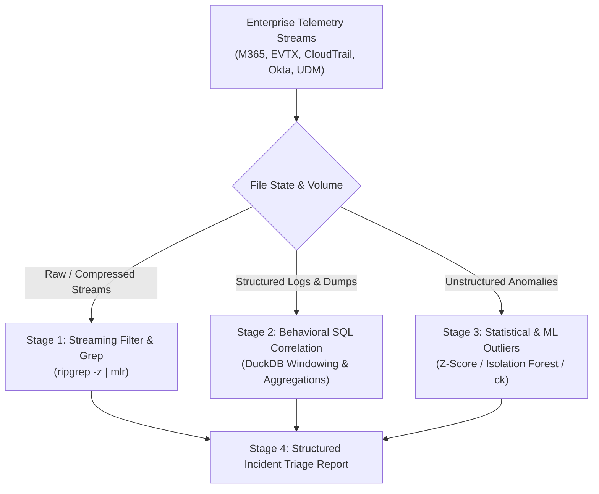

# Log & Telemetry Forensics Analysis Reference

Forensic schema discovery, multi-source timeline correlation, temporal anomaly detection, semantic search, and statistical/ML threat hunting across enterprise event streams (M365 Unified Audit Logs, Windows EVTX, AWS CloudTrail, Okta System Logs, Google SecOps UDM, and raw JSONL/CSV).

---

## 1. Toolchain, Primitives & Circuit Breakers

| Tool / Reference | Capabilities & Target Scope | Safety Protocol / Circuit Breaker |
| :--- | :--- | :--- |
| **`duckdb`** | Zero-ingestion SQL analytics on JSONL, Parquet, and CSV archives | Single-quote file paths (`FROM 'logs.jsonl'`); always include `-bail` and `LIMIT 25`. |
| **`ripgrep` (`rg`)** | Streaming regex matching across cleartext and compressed files (`-z`) | Use `-z` for `.gz` logs; pair with `-C 1` to prevent context floods. |
| **`mlr` (Miller)** | In-stream schema unification and columnar transformations | Chain streaming verbs (`filter`, `cut`, `unsparsify`) before aggregations. |
| **Interactive TUI Isolation** | Running interactive terminal viewers like lnav hangs headless subshells | Use `rg` or `duckdb` in automation; recommend `lnav` strictly to human users. |
| **`references/google_secops_udm.md`** | Google SecOps UDM actor-action-target and YARA-L mapping | Consult when investigating Chronicle security telemetry or building detection rules. |
| **`references/okta_logs.md`** | Okta identity events, MFA push bombing, and ITDR recipes | Consult when investigating authentication storms or identity provider anomalies. |

---

## 2. Investigation Funnel Matrix



| Stage | Operation / Focus | Exact Tool Command | Finding Signal / Triaged Indicator |
| :--- | :--- | :--- | :--- |
| **Stage 1: Streaming Filter & Grep** | Regex & Stream Slice | `rg -z -i "PATTERN" logs/*.gz` | Fast discovery of critical exceptions, unauthorized codes, error floods. |
| **Stage 2: Behavioral SQL Correlation** | Timeline & Window Deltas | `duckdb -json -bail -c "SQL"` | Flags impossible travel (`LAG()`), brute-force spikes, and privilege grants. |
| **Stage 3: Statistical & ML Outliers** | Statistical Anomaly Hunting | `duckdb -c "SELECT ... WHERE ABS(z) > 3"` | Isolates data exfiltration spikes and rare unclustered log messages. |

---

## 3. Telemetry Sources & Analytical Matrix

| Telemetry Source | Formats | Ingestion Syntax / Path | Key Fields & Indicators to Extract |
| :--- | :--- | :--- | :--- |
| **M365 UAL** | `.json`, `.jsonl` | `FROM 'm365_*.json'` | `CreationTime`, `Operation`, `AuditData->>'UserId'`, `AuditData->>'ClientIP'` |
| **Windows EVTX** | `.jsonl`, `.csv` | `FROM 'win_sec_*.jsonl'` | `EventID` (`4624`, `4625`, `4688`, `4672`), `EventData->>'TargetUserName'` |
| **AWS CloudTrail** | `.json.gz` | `SELECT unnest(Records) FROM read_json(...)` | `r->>'eventTime'`, `r->>'eventName'`, `r->'userIdentity'->>'arn'` |
| **Okta System Logs** | `.jsonl`, `.json` | `FROM 'okta_*.jsonl'` | `published`, `eventType`, `actor->>'alternateId'`, `outcome->>'result'` |
| **Web / Access Logs** | `.csv`, `.tsv` | `read_csv('access.log', header=true)` | `timestamp`, `client_ip`, `request_uri`, `status_code`, `user_agent` |

---

## 4. Structured Output / Finding Schema

```markdown
### Security Incident Triage: INCIDENT_ID
* **Investigation Window:** START_TIME to END_TIME | Total Records: TOTAL_COUNT
* **Correlated Actor & Entity:**
  - Principal: `user@company.com` (Target: `AzureAD / Entra ID`)
  - Source IP: `198.51.100.42` (ASN: ASN_NAME, Geolocation: GEO_LOC)
* **Observed Threat Signals:**
  - Rate Spike: 45 failed logons within 60 seconds (`EventID 4625`)
  - Impossible Travel: Session transition from AU to US within 15 minutes
* **Recommended Containment:** Revoke active refresh tokens; isolate compromised credential.
```

---

## 5. High-Leverage Composite Triage Examples

```bash
# Stage 1: Streaming Filter & Grep on compressed logs
rg -z -i "(unauthorized|access denied|failed logon|elevateaccess)" logs/auth_*.json.gz | head -n 25

# Stage 2: Behavioral SQL Correlation for rate spikes & brute-force detection in DuckDB
duckdb -json -bail -c "
SELECT 
    timestamp, 
    client_ip,
    COUNT(*) OVER (
        PARTITION BY client_ip 
        ORDER BY timestamp::TIMESTAMP 
        RANGE BETWEEN INTERVAL '1 minute' PRECEDING AND CURRENT ROW
    ) AS requests_per_min
FROM read_csv('auth_events.csv', header=true)
QUALIFY requests_per_min > 20
ORDER BY requests_per_min DESC
LIMIT 25;
"

# Stage 3: Statistical & ML Outliers and multi-source timeline merge with row-count verification
duckdb -bail -c "
COPY (
    SELECT 'M365' AS source, CreationTime::TIMESTAMP AS event_time, AuditData->>'ClientIP' AS client_ip, Operation AS detail
    FROM read_json('m365_audit.json')
    UNION ALL
    SELECT 'OKTA' AS source, published::TIMESTAMP AS event_time, client->>'ipAddress' AS client_ip, eventType AS detail
    FROM read_json('okta_logs.jsonl')
) TO 'triage_timeline.parquet' (FORMAT PARQUET, COMPRESSION ZSTD);
"
duckdb -bail -c "SELECT count(*) FROM 'triage_timeline.parquet';"
```
