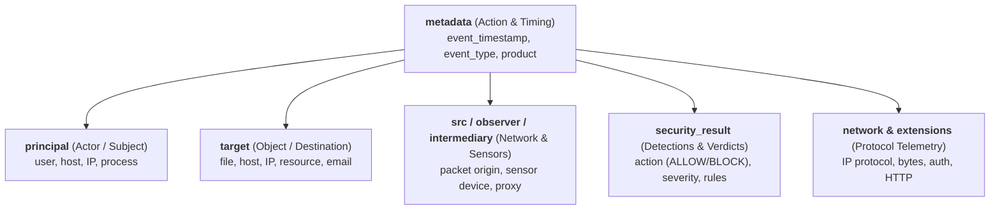

# Appendix: Google SecOps Unified Data Model (UDM) Reference

This appendix provides a structured guide to the **Google SecOps (formerly Chronicle SIEM)** Unified Data Model (UDM). It outlines the core schema hierarchy, event taxonomy, field mappings across major log sources, and ready-to-run DuckDB SQL recipes for analyzing UDM-structured JSON, JSONL, and Parquet exports.

---

## 1. UDM Core Architecture: The Noun-Verb Model

Google SecOps structures all normalized security telemetry around a standard **Actor-Action-Target** model:



### Core Top-Level Objects

| Object | Data Structure | Role / Definition | Key Sub-Fields |
| :--- | :--- | :--- | :--- |
| **`metadata`** | `Object` | Contextual event envelope information, classification, and timing | `event_timestamp`, `event_type`, `product_name`, `vendor_name`, `product_event_type`, `description`, `id` |
| **`principal`** | `Noun (Object)` | The active entity (user, host, process) that performed or initiated the action | `user.userid`, `user.email_addresses[]`, `ip[]`, `hostname`, `asset.hostname`, `asset.asset_id`, `process.command_line`, `process.file.full_path`, `location` |
| **`target`** | `Noun (Object)` | The entity affected by or receiving the action (destination host, file, user, cloud resource) | `user.userid`, `ip[]`, `port`, `hostname`, `asset.hostname`, `file.full_path`, `file.sha256`, `resource.name`, `url`, `domain` |
| **`src`** | `Noun (Object)` | Origin entity or context where an object resided prior to an action | `ip[]`, `port`, `hostname`, `mac[]`, `file.full_path` |
| **`observer`** | `Noun (Object)` | The passive sensor or appliance that recorded the event without being a direct participant | `hostname`, `ip[]`, `product_name`, `location` |
| **`intermediary`** | `Array[Object]` | Intermediate proxy, load balancer, mail relay, or NAT gateway hops through which traffic passed | `ip[]`, `port`, `hostname` |
| **`security_result`** | `Array[Object]` | Array of security verdicts, alert classifications, and detection metadata | `action` (`ALLOW`, `BLOCK`, `QUARANTINE`, `CHALLENGE`, `FAIL`), `severity` (`LOW`, `HIGH`, `CRITICAL`), `category[]`, `rule_name`, `summary`, `threat_name` |
| **`network`** | `Object` | Layer 3/4/7 network protocol telemetry | `ip_protocol` (`TCP`, `UDP`, `ICMP`), `direction` (`INBOUND`, `OUTBOUND`, `LATERAL`), `sent_bytes`, `received_bytes`, `session_duration` |
| **`extensions`** | `Object` | Context-specific typed schemas for protocols and domain telemetry | `extensions.auth`, `extensions.http`, `extensions.vuln` |
| **`about`** | `Array[Object]` | Secondary/referenced entities involved in the event (e.g. loaded modules, email attachments) | Array of entity structs matching principal/target schema |

---

## 2. Core UDM Event Taxonomy (`metadata.event_type`)

### A. Authentication & User Management Events

| UDM `event_type` | Description | Typical Log Sources |
| :--- | :--- | :--- |
| **`USER_LOGIN`** | Successful or failed interactive/SSO authentication | Okta, Azure AD, Windows EVTX 4624/4625 |
| **`USER_LOGOUT`** | User session termination | Okta, Azure AD, Windows EVTX 4634 |
| **`USER_CHANGE_PASSWORD`**| Password change or credential reset event | Okta, Azure AD, Active Directory |
| **`USER_CREATION`** | New local or directory user account provisioned | Active Directory (4720), Okta, Azure AD |
| **`USER_DELETION`** | User account deleted or decommissioned | Active Directory (4726), Okta, Azure AD |
| **`GROUP_MODIFICATION`**| User added or removed from directory security group | Active Directory (4728/4729), Okta, Azure AD |
| **`USER_UNCATEGORIZED`** | Miscellaneous user state modifications (MFA resets, status updates) | Okta, Azure AD, Active Directory |

### B. Process & Host Lifecycle

| UDM `event_type` | Description | Typical Log Sources |
| :--- | :--- | :--- |
| **`PROCESS_LAUNCH`** | Process execution on host | Windows 4688, Sysmon EventID 1, CrowdStrike, EDR |
| **`PROCESS_TERMINATION`**| Process lifecycle stop | Windows 4689, Sysmon EventID 5, EDR |
| **`PROCESS_MODULE_LOAD`** / **`MODULE_LOAD`** | DLL or dynamic library load | Sysmon EventID 7, EDR |
| **`PROCESS_INJECTION`** | Cross-process memory injection / hollowing | EDR, Sysmon EventID 8/10 |
| **`SERVICE_CREATION`** | New Windows service installed (persistence indicator) | Windows 7045, Sysmon EventID 1 |
| **`SCHEDULED_TASK_CREATION`**| Scheduled task registered on system | Windows 4698, Sysmon EventID 1 |
| **`REGISTRY_MODIFICATION`**| Registry key or value created, modified, or deleted | Sysmon EventID 12/13/14, EDR |
| **`MUTEX_CREATION`** | Named mutex created on host | Sysmon EventID 17/18, EDR |

### C. Network & Protocol Telemetry

| UDM `event_type` | Description | Typical Log Sources |
| :--- | :--- | :--- |
| **`NETWORK_CONNECTION`** | TCP/UDP session flow | Firewall, AWS VPC Flow Logs, Proxy |
| **`NETWORK_HTTP`** | Layer 7 Web traffic | Proxy, Apache, Nginx, Cloudflare |
| **`NETWORK_DNS`** | DNS resolution queries & responses | CoreDNS, Infoblox, Windows DNS |
| **`NETWORK_DHCP`** | IP lease & renewal events | DHCP Server Logs |

### D. File System & Cloud Resource Events

| UDM `event_type` | Description | Typical Log Sources |
| :--- | :--- | :--- |
| **`FILE_CREATION`** | New file written to disk | Sysmon EventID 11, EDR |
| **`FILE_MODIFICATION`** | Existing file altered | Sysmon EventID 11, EDR |
| **`FILE_DELETION`** | File deleted from filesystem | Sysmon EventID 23, EDR |
| **`FILE_MOVE`** | File renamed or moved | Sysmon EventID 11, EDR |
| **`EMAIL_TRANSACTION`** | Email delivery, forwarding, or inbound gateway scan | M365, Proofpoint, Exchange |
| **`USER_RESOURCE_ACCESS`**| Cloud storage, SharePoint, AWS S3 object access | M365 UAL, AWS CloudTrail, Google Workspace |
| **`SCAN_NETWORK`** | Port scan or reconnaissance detection | IDS/IPS, Sensor Alerts |
| **`STATUS_UPDATE`** | System health, service status, agent keep-alive | System Monitoring, Agent Telemetry |

---

## 3. Log Source to UDM Field Mapping Guide

| Source Telemetry | Raw Field | Mapped UDM Field Path | Example UDM Value |
| :--- | :--- | :--- | :--- |
| **Windows EVTX 4624/4625** | `TargetUserName` | `target.user.userid` | `"jsmith"` |
| | `IpAddress` | `principal.ip[0]` | `"192.168.1.50"` |
| | `Status` / `SubStatus` | `security_result[0].action` | `"BLOCK"` (or `"ALLOW"`) |
| **Windows EVTX 4688 / Sysmon** | `NewProcessName` | `target.process.file.full_path` | `"C:\Windows\System32\cmd.exe"` |
| | `CommandLine` | `target.process.command_line` | `"cmd.exe /c whoami /all"` |
| | `ParentProcessName` | `principal.process.file.full_path` | `"C:\Windows\explorer.exe"` |
| **Microsoft 365 UAL** | `UserId` | `principal.user.userid` | `"alice@corpnet.io"` |
| | `ClientIP` | `principal.ip[0]` | `"203.0.113.15"` |
| | `Operation` | `metadata.product_event_type` | `"FileDownloaded"` |
| | `ObjectId` | `target.resource.name` | `"Financial_Report_Q3.xlsx"` |
| **AWS CloudTrail** | `userIdentity.arn` | `principal.user.user_display_name` | `"arn:aws:iam::123:user/Admin"` |
| | `eventName` | `metadata.product_event_type` | `"AssumeRole"` |
| | `sourceIPAddress` | `principal.ip[0]` | `"198.51.100.22"` |
| **Okta System Logs** | `actor.alternateId` | `principal.user.userid` | `"alice@corpnet.io"` |
| | `client.ipAddress` | `principal.ip[0]` | `"198.51.100.22"` |
| | `eventType` | `metadata.product_event_type` | `"user.session.start"` |
| | `outcome.result` | `security_result[0].action` | `"ALLOW"` (or `"BLOCK"`) |
| | `target[0].displayName`| `target.resource.name` | `"AWS SSO Portal"` |

---

## 4. Zero-Ingestion DuckDB SQL Recipes for UDM Datasets

Because UDM files are exported as structured JSON Lines (`.jsonl`), nested JSON, or Parquet, agents can query them directly using DuckDB CLI with zero database setup.

### A. Authentication Triage: Failed Logins & Brute-Force Hunting
```bash
duckdb -json -bail -c "
SELECT 
    metadata->>'event_timestamp' AS timestamp,
    principal->'user'->>'userid' AS user_id,
    principal->'ip'->>0 AS source_ip,
    target->'asset'->>'hostname' AS target_host,
    security_result->0->>'action' AS action,
    security_result->0->>'summary' AS failure_reason
FROM read_json('secops_udm_events.jsonl')
WHERE metadata->>'event_type' = 'USER_LOGIN'
  AND security_result->0->>'action' = 'BLOCK'
ORDER BY timestamp DESC
LIMIT 25;
"
```

### B. Impossible Travel & Rapid IP Hopping (`LAG()` Window Function)
Detects users logging in from different public IP addresses in under 60 minutes:
```bash
duckdb -json -bail -c "
SELECT 
    principal->'user'->>'userid' AS user_id,
    metadata->>'event_timestamp' AS login_time,
    principal->'ip'->>0 AS current_ip,
    LAG(principal->'ip'->>0) OVER w AS prev_ip,
    date_diff('minute', 
        LAG(TRY_CAST(metadata->>'event_timestamp' AS TIMESTAMP)) OVER w, 
        TRY_CAST(metadata->>'event_timestamp' AS TIMESTAMP)
    ) AS mins_since_prev_login
FROM read_json('secops_udm_events.jsonl')
WHERE metadata->>'event_type' = 'USER_LOGIN'
WINDOW w AS (PARTITION BY principal->'user'->>'userid' ORDER BY metadata->>'event_timestamp')
QUALIFY prev_ip IS NOT NULL 
    AND current_ip != prev_ip 
    AND mins_since_prev_login < 60
ORDER BY login_time DESC
LIMIT 25;
"
```

### C. Suspicious Process Execution & Parent-Child Tree (`PROCESS_LAUNCH`)
Flags command-line executions spawned by web servers, office applications, or script interpreters:
```bash
duckdb -json -bail -c "
SELECT 
    metadata->>'event_timestamp' AS timestamp,
    principal->'asset'->>'hostname' AS host,
    principal->'process'->'file'->>'full_path' AS parent_process,
    target->'process'->'file'->>'full_path' AS launched_process,
    target->'process'->>'command_line' AS command_line
FROM read_json('secops_udm_events.jsonl')
WHERE metadata->>'event_type' = 'PROCESS_LAUNCH'
  AND (
      target->'process'->>'command_line' ILIKE '%powershell%'
      OR target->'process'->>'command_line' ILIKE '%certutil%'
      OR target->'process'->>'command_line' ILIKE '%mshta%'
      OR target->'process'->>'command_line' ILIKE '%curl %'
      OR target->'process'->>'command_line' ILIKE '%vssadmin%'
  )
ORDER BY timestamp DESC
LIMIT 25;
"
```

### D. Outbound C2 Beacons & Data Exfiltration (`NETWORK_HTTP`)
Identifies high-volume outbound POST requests and long-tail rare user-agents:
```bash
duckdb -json -bail -c "
SELECT 
    principal->'asset'->>'hostname' AS internal_host,
    target->>'domain' AS destination_domain,
    target->'ip'->>0 AS dest_ip,
    extensions->'http'->>'method' AS http_method,
    extensions->'http'->>'user_agent' AS user_agent,
    SUM(TRY_CAST(network->>'sent_bytes' AS BIGINT)) AS total_bytes_out,
    COUNT(*) AS connection_count
FROM read_json('secops_udm_events.jsonl')
WHERE metadata->>'event_type' IN ('NETWORK_HTTP', 'NETWORK_CONNECTION')
  AND network->>'direction' = 'OUTBOUND'
GROUP BY 1, 2, 3, 4, 5
ORDER BY total_bytes_out DESC
LIMIT 20;
"
```

### E. Unnesting Multi-Value UDM Arrays (`unnest`)
UDM fields such as `principal.ip`, `target.ip`, and `security_result` are arrays. Use DuckDB's `unnest()` to flatten them into discrete relational rows:
```bash
duckdb -json -bail -c "
SELECT 
    metadata->>'event_timestamp' AS timestamp,
    metadata->>'event_type' AS event_type,
    unnest(security_result)->>'rule_name' AS triggered_rule,
    unnest(security_result)->>'severity' AS severity,
    unnest(security_result)->>'action' AS action
FROM read_json('secops_udm_events.jsonl')
WHERE len(security_result) > 0
ORDER BY timestamp DESC
LIMIT 25;
"
```

---

## 5. Chronicle YARA-L 2.0 to DuckDB SQL Conversion Cheatsheet

When migrating or testing Google SecOps YARA-L detection logic offline:

| YARA-L 2.0 Concept | YARA-L Syntax | DuckDB SQL Equivalent |
| :--- | :--- | :--- |
| **Event Filter** | `$e.metadata.event_type = "USER_LOGIN"` | `WHERE metadata->>'event_type' = 'USER_LOGIN'` |
| **Match Window** | `match: $user over 5m` | `WINDOW w AS (PARTITION BY user ORDER BY ts RANGE BETWEEN INTERVAL '5 minutes' PRECEDING AND CURRENT ROW)` |
| **Threshold Condition** | `condition: #fail >= 5 and $success` | `HAVING COUNT(CASE WHEN action = 'BLOCK' THEN 1 END) >= 5 AND COUNT(CASE WHEN action = 'ALLOW' THEN 1 END) >= 1` |
| **Regex Match** | `$e.target.process.command_line = /powershell/ nocase` | `regexp_matches(target->'process'->>'command_line', '(?i)powershell')` |
| **State Comparison** | `$e1.principal.ip != $e2.principal.ip` | `LAG(principal->'ip'->>0) OVER w != principal->'ip'->>0` |

### Example: Multi-Event Brute Force Detection (YARA-L 2.0 $\leftrightarrow$ DuckDB)

```sql
-- YARA-L 2.0:
// events: $fail.metadata.event_type = "USER_LOGIN" and $fail.security_result.action = "BLOCK"
//         $succ.metadata.event_type = "USER_LOGIN" and $succ.security_result.action = "ALLOW"
// match: $user over 10m
// condition: #fail >= 5 and $succ

-- DuckDB Offline SQL Equivalent:
SELECT 
    principal->'user'->>'userid' AS user_id,
    COUNT(CASE WHEN security_result->0->>'action' = 'BLOCK' THEN 1 END) AS failed_attempts,
    COUNT(CASE WHEN security_result->0->>'action' = 'ALLOW' THEN 1 END) AS successful_attempts,
    MIN(metadata->>'event_timestamp') AS first_attempt,
    MAX(metadata->>'event_timestamp') AS last_attempt
FROM read_json('secops_udm_events.jsonl')
WHERE metadata->>'event_type' = 'USER_LOGIN'
GROUP BY 1
HAVING failed_attempts >= 5 AND successful_attempts >= 1
ORDER BY last_attempt DESC
LIMIT 25;
```
