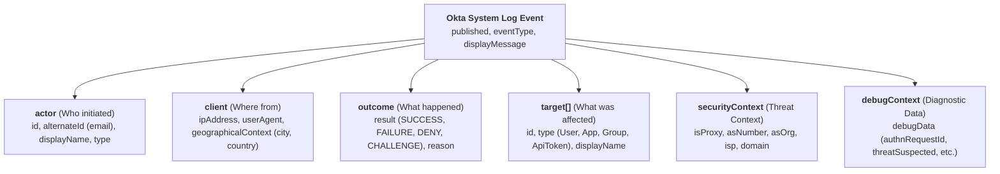

# Appendix: Okta System Log Investigation & Event Reference

This appendix provides a structured guide to analyzing **Okta System Logs** exported as JSON Lines (`.jsonl`), nested JSON, or CSV. It outlines the schema architecture, critical event types for threat hunting, and ready-to-run DuckDB SQL recipes for rapid identity threat detection and response (ITDR).

---

## 1. Okta System Log Architecture

Okta records every user action, authentication attempt, administrative modification, and system event in a structured JSON object:



### Core Top-Level Fields

| Field Path | Type | Description / Investigation Role |
| :--- | :--- | :--- |
| **`published`** | `String` (ISO-8601) | Exact event timestamp in UTC (e.g. `"2026-08-29T04:12:00.000Z"`). |
| **`eventType`** | `String` | Canonical dot-delimited event identifier (e.g. `user.session.start`, `system.api_token.create`). |
| **`displayMessage`** | `String` | Official human-readable summary string (e.g. `"User single sign on to app"`). |
| **`actor.alternateId`** | `String` | Primary identifier (email / username) of the entity executing the action. |
| **`actor.type`** | `String` | Entity category: `User`, `SystemPrincipal`, `AppAgent`. |
| **`client.ipAddress`** | `String` | Source IP address initiating the request. |
| **`client.geographicalContext`**| `Object` | Geo-location metadata (`city`, `state`, `country`, `postalCode`, `geolocation`). |
| **`client.userAgent`** | `Object` | Client browser & OS telemetry (`rawUserAgent`, `os`, `browser`). |
| **`outcome.result`** | `String` | Outcome status enum: `SUCCESS`, `FAILURE`, `ABANDONED`, `DENY`, `ALLOW`, `CHALLENGE`, `SKIPPED`, `UNKNOWN`. |
| **`outcome.reason`** | `String` | Specific failure reason or error code (e.g. `"INVALID_CREDENTIALS"`, `"LOCKED_OUT"`, `"User did not complete MFA verification"`). |
| **`target`** | `Array[Object]` | List of resources acted upon (target users, applications, MFA factors, groups, API tokens). |
| **`transaction.id`** | `String` | Correlates multiple log events generated during a single HTTP request/transaction. |
| **`securityContext.isProxy`** | `Boolean` | Flag indicating if request originated through a proxy, VPN, TOR exit node, or anonymizer. |
| **`securityContext.asOrg`** | `String` | Autonomous System Organization / ISP name (e.g. `"Cloudflare, Inc."`, `"DigitalOcean"`). |
| **`debugContext.debugData`** | `Object` | Dynamic diagnostic attributes (e.g. `authnRequestId`, `requestId`, `requestUri`, `threatSuspected`). |
| **`authenticationContext`** | `Object` | Auth session tracking (`externalSessionId`, `rootSessionId`, `credentialType`, `authenticationProvider`). |

---

## 2. Common Okta Event Types (`eventType`) Reference

### A. Authentication, Session & Sign-On

| `eventType` | `displayMessage` | Outcome | Threat Hunting Significance |
| :--- | :--- | :--- | :--- |
| **`user.session.start`** | `"User login to Okta"` | `SUCCESS` / `FAILURE` | Primary login to Okta (establishing the Okta session/dashboard). Check for off-hours logins, new ASN/ISP, or unusual countries. |
| **`user.authentication.sso`** | `"User single sign on to app"` | `SUCCESS` / `FAILURE` | **Downstream SSO**: User authenticates into a federated app (AWS, Slack, Salesforce, GitHub) using their Okta session. Target app in `target[0].displayName`. |
| **`user.session.end`** | `"User logout of Okta"` | `SUCCESS` | Normal session termination. |
| **`user.session.access_admin_app`** | `"User accessing Okta admin app"` | `SUCCESS` / `DENY` | Administrator access to the Okta Admin Console (`/admin/dashboard`). Audit closely for non-admin accounts. |
| **`user.authentication.authenticate`** | `"Authenticate user"` | `SUCCESS` / `FAILURE` | Primary credential evaluation step against Okta / Active Directory. |
| **`user.authentication.verify`** | `"Verify user identity"` | `SUCCESS` / `FAILURE` | Specific factor or identity verification step. |
| **`user.authentication.auth_via_mfa`** | `"Authenticate user via MFA"` | `SUCCESS` / `FAILURE` / `ABANDONED` | MFA challenge evaluation step during sign-on. Emits `ABANDONED` if user/attacker closes prompt or times out. |
| **`user.authentication.auth_via_richclient`**| `"Authenticate user via Rich Client"` | `SUCCESS` / `FAILURE` | Non-browser authentication (PowerShell, CLI, IMAP/POP3). Common in password spraying. |
| **`app.generic.unauth_app_access_attempt`**| `"User attempted unauthorized access to app"` | `DENY` / `FAILURE` | Unauthorized access attempt to an application bookmark or embed link. |
| **`policy.evaluate_sign_on`** | `"Evaluation of sign-on policy"` | `ALLOW` / `DENY` / `CHALLENGE` | Core policy evaluation event recording rule matching, zone criteria, and risk level. |
| **`application.policy.sign_on.deny_access`**| `"Deny access to application"` | `DENY` | Access blocked by an application sign-on policy rule (e.g. forbidden country, unmanaged device). |

### B. MFA & Factor Lifecycle (High Value for Account Takeover)

| `eventType` | `displayMessage` | Threat Hunting Significance |
| :--- | :--- | :--- |
| **`user.mfa.factor.activate`** | `"Activate MFA factor"` | **Critical indicator**: Attacker enrolling their own device (Okta Verify, WebAuthn, SMS) following credential compromise. |
| **`user.mfa.factor.deactivate`** | `"Deactivate MFA factor"` | Removal of an existing security factor. |
| **`user.mfa.factor.reset_all`** | `"Reset all factors for user"` | Admin or self-service clearing of all enrolled factors. |
| **`user.mfa.okta_verify.deny_push`** | `"User deny Okta Verify push"` | **MFA Fatigue / Prompt Bombing**: User actively denied push notification. Look for multiple denials followed by a single success. |
| **`user.authentication.auth_via_mfa`** (`outcome.result = 'ABANDONED'`) | `"Authenticate user via MFA"` | **MFA Abandonment / Stolen Password**: Primary password was valid, but the MFA prompt was abandoned or timed out. Strong signal of credential stuffing. |
| **`user.mfa.attempt_bypass`** | `"Attempt to bypass MFA factor"` | Anomaly indicating repeated invalid factor responses or tampering. |

### C. Account Lifecycle & Privilege Escalation

| `eventType` | `displayMessage` | Threat Hunting Significance |
| :--- | :--- | :--- |
| **`user.account.lock`** / **`user.account.lock.limit`** | `"Lock user account"` / `"User account lockout limit reached"` | Account locked out after reaching max consecutive failed attempts (brute-force alert). |
| **`user.account.unlock_token`** | `"User unlock token"` | Sent during self-service account unlock flows. |
| **`user.account.update_password`** | `"Update password for user"` | Password change. Correlate with recent suspicious logins or reset tokens. |
| **`user.account.privilege.grant`** | `"Grant user admin privilege"` | **Privilege Escalation**: User assigned Super Admin, Org Admin, or App Admin role. |
| **`user.account.privilege.revoke`** | `"Revoke user admin privilege"` | Removal of administrative rights. |
| **`group.user_membership.add`** | `"Add user to group membership"` | User added to sensitive directory groups (e.g. `"Domain Admins"`, `"AWS-Production-Access"`). |

### D. System Security, Tokens & Persistence

| `eventType` | `displayMessage` | Threat Hunting Significance |
| :--- | :--- | :--- |
| **`system.api_token.create`** | `"Create API token"` | **Persistence**: Administrator API token generated. Often used by attackers to maintain access outside UI. |
| **`system.api_token.revoke`** | `"Revoke API token"` | API token deletion. |
| **`system.idp.lifecycle.create`** | `"Create Identity Provider"` | **SAML/OIDC Trust Tampering**: Rogue IdP added for backdoor federated authentication. |
| **`system.idp.lifecycle.update`** | `"Update Identity Provider"` | Modification of existing IdP certificate, entity ID, or endpoints. |
| **`policy.lifecycle.update`** | `"Update policy"` | Sign-on or MFA policy altered (e.g. disabling MFA requirements for specific IP ranges). |
| **`security.threat.detected`** | `"Threat detected by ThreatInsight"` | Okta ThreatInsight flagged an IP for suspicious password spraying or credential stuffing. |

---

## 3. Zero-Ingestion DuckDB SQL Recipes for Okta Logs

Query Okta System Log JSON / JSONL exports directly with zero database setup using DuckDB CLI.

### A. Password Spraying & Brute-Force Triage
Identifies single IP addresses attempting logins across multiple distinct user accounts:
```bash
duckdb -json -bail -c "
SELECT 
    client->>'ipAddress' AS src_ip,
    client->'geographicalContext'->>'country' AS country,
    client->'geographicalContext'->>'city' AS city,
    COUNT(DISTINCT actor->>'alternateId') AS distinct_targeted_users,
    COUNT(*) AS total_failed_attempts,
    MIN(published) AS first_attempt,
    MAX(published) AS last_attempt
FROM read_json('okta_system_logs.jsonl')
WHERE eventType IN ('user.session.start', 'user.authentication.authenticate')
  AND outcome->>'result' = 'FAILURE'
GROUP BY 1, 2, 3
HAVING total_failed_attempts >= 5
ORDER BY total_failed_attempts DESC
LIMIT 25;
"
```

### B. MFA Fatigue / Prompt Bombing Detection
Detects accounts where users rejected multiple Okta Verify push notifications:
```bash
duckdb -json -bail -c "
SELECT 
    published,
    actor->>'alternateId' AS user_email,
    client->>'ipAddress' AS src_ip,
    client->'geographicalContext'->>'city' AS city,
    client->'userAgent'->>'browser' AS browser,
    eventType,
    outcome->>'result' AS outcome,
    outcome->>'reason' AS reason
FROM read_json('okta_system_logs.jsonl')
WHERE eventType IN ('user.mfa.okta_verify.deny_push', 'user.session.start')
  AND actor->>'alternateId' IN (
      SELECT actor->>'alternateId'
      FROM read_json('okta_system_logs.jsonl')
      WHERE eventType = 'user.mfa.okta_verify.deny_push'
      GROUP BY 1
      HAVING COUNT(*) >= 2
  )
ORDER BY published DESC
LIMIT 50;
"
```

### C. Impossible Travel & Geo-Hopping (`LAG()` Window Function)
Identifies users authenticating from different countries or cities within 60 minutes:
```bash
duckdb -json -bail -c "
SELECT 
    actor->>'alternateId' AS user_email,
    published,
    client->>'ipAddress' AS current_ip,
    client->'geographicalContext'->>'city' AS current_city,
    client->'geographicalContext'->>'country' AS current_country,
    LAG(client->>'ipAddress') OVER w AS prev_ip,
    LAG(client->'geographicalContext'->>'country') OVER w AS prev_country,
    date_diff('minute', 
        LAG(TRY_CAST(published AS TIMESTAMP)) OVER w, 
        TRY_CAST(published AS TIMESTAMP)
    ) AS mins_since_prev_event
FROM read_json('okta_system_logs.jsonl')
WHERE eventType = 'user.session.start'
  AND outcome->>'result' = 'SUCCESS'
WINDOW w AS (PARTITION BY actor->>'alternateId' ORDER BY published)
QUALIFY prev_country IS NOT NULL 
    AND current_country != prev_country 
    AND mins_since_prev_event < 60
ORDER BY published DESC
LIMIT 25;
"
```

### D. New MFA Factor Enrollment on Existing Accounts (Persistence Hunt)
Flags new MFA device activations, showing the actor and client IP:
```bash
duckdb -json -bail -c "
SELECT 
    published,
    actor->>'alternateId' AS user_email,
    client->>'ipAddress' AS enrollment_ip,
    client->'geographicalContext'->>'country' AS country,
    client->'userAgent'->>'rawUserAgent' AS user_agent,
    displayMessage,
    target->0->>'displayName' AS enrolled_factor_type
FROM read_json('okta_system_logs.jsonl')
WHERE eventType = 'user.mfa.factor.activate'
ORDER BY published DESC
LIMIT 25;
"
```

### E. API Token Generation & Administrative Privilege Grants
Flags creation of long-lived API tokens or administrative privilege escalations:
```bash
duckdb -json -bail -c "
SELECT 
    published,
    eventType,
    actor->>'alternateId' AS executed_by,
    client->>'ipAddress' AS src_ip,
    displayMessage,
    target->0->>'displayName' AS target_name,
    target->0->>'type' AS target_type
FROM read_json('okta_system_logs.jsonl')
WHERE eventType IN (
    'system.api_token.create',
    'user.account.privilege.grant',
    'system.idp.lifecycle.create',
    'system.idp.lifecycle.update',
    'policy.lifecycle.update'
)
ORDER BY published DESC
LIMIT 25;
"
```

### F. Anonymizer / Proxy / Tor Authentication Slicing
Flags logins originating from anonymizing proxies, VPNs, or hosting providers:
```bash
duckdb -json -bail -c "
SELECT 
    published,
    actor->>'alternateId' AS user_email,
    client->>'ipAddress' AS src_ip,
    securityContext->>'isProxy' AS is_proxy,
    securityContext->>'asOrg' AS asn_org,
    client->'geographicalContext'->>'country' AS country,
    outcome->>'result' AS result
FROM read_json('okta_system_logs.jsonl')
WHERE eventType = 'user.session.start'
  AND (
      securityContext->>'isProxy' = 'true'
      OR securityContext->>'asOrg' ILIKE '%DigitalOcean%'
      OR securityContext->>'asOrg' ILIKE '%OVH%'
      OR securityContext->>'asOrg' ILIKE '%Linode%'
      OR securityContext->>'asOrg' ILIKE '%M247%'
  )
ORDER BY published DESC
LIMIT 25;
"
```

### G. MFA Abandonment Detection (`outcome.result = 'ABANDONED'`)
Flags MFA challenge prompts where the user/attacker provided a valid password but closed the window, timed out, or abandoned the second factor:
```bash
duckdb -json -bail -c "
SELECT 
    published,
    actor->>'alternateId' AS user_email,
    client->>'ipAddress' AS client_ip,
    client->'geographicalContext'->>'country' AS country,
    client->'userAgent'->>'browser' AS browser,
    debugContext->'debugData'->>'authnRequestId' AS auth_request_id,
    outcome->>'result' AS outcome,
    outcome->>'reason' AS reason
FROM read_json('okta_system_logs.jsonl')
WHERE eventType = 'user.authentication.auth_via_mfa'
  AND outcome->>'result' = 'ABANDONED'
ORDER BY published DESC
LIMIT 25;
"
```
