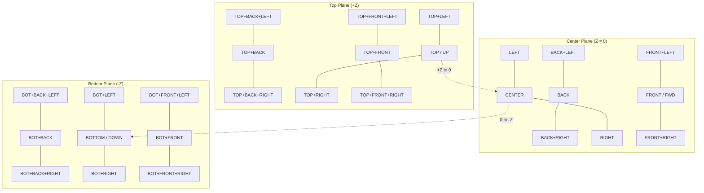
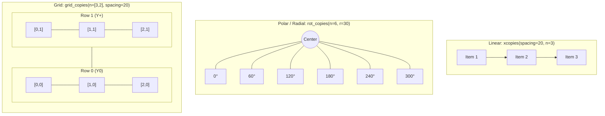
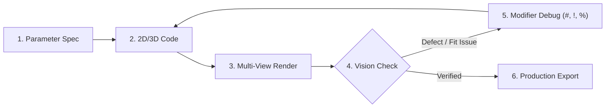

# OpenSCAD & BOSL2 Agent Guide

This document covers what LLMs get wrong when writing OpenSCAD — traps, anti-patterns, declarative architecture, and practical rules that aren't in the manual. It does **not** duplicate the full language reference; consult the official docs and BOSL2 wiki links for exhaustive syntax details.

## Official References

Look up primitives, transforms, functions, and modules here — do not guess syntax from memory:
- **Cheat Sheet**: [openscad.org/cheatsheet](https://openscad.org/cheatsheet/)
- **Full Manual**: [OpenSCAD Wikibook](https://en.wikibooks.org/wiki/OpenSCAD_User_Manual/The_OpenSCAD_Language)
- **CLI Usage**: [Command-Line Reference](https://en.wikibooks.org/wiki/OpenSCAD_User_Manual/Using_OpenSCAD_in_a_command_line_environment)
- **BOSL2 Main Wiki**: [github.com/BelfrySCAD/BOSL2/wiki](https://github.com/BelfrySCAD/BOSL2/wiki)
- **BOSL2 Cheat Sheet**: [BOSL2 Cheat Sheet Wiki](https://github.com/BelfrySCAD/BOSL2/wiki/CheatSheet)
- **BOSL2 Tutorials**: [BOSL2 Tutorials Index](https://github.com/BelfrySCAD/BOSL2/wiki/Tutorials)

---

## Mental Model Shifts

OpenSCAD is **declarative and functional**, not imperative.

### Variables Are Compile-Time Constants (SSA)
All assignments are evaluated at compile time. You cannot mutate a variable. Reassignment shadows it within that scope only, and the **last assigned value in a scope wins** for all references in that scope.

```openscad
// WRONG — expecting mutation
x = 5;
if (condition) {
    x = 10; // Shadows x ONLY inside this block
}
// x is still 5 here!

// CORRECT — ternary for conditional values
x = condition ? 10 : 5;
```

**List comprehensions for collections:**
```openscad
// Modern OpenSCAD: list comprehension instead of recursion
coords = [for (i = [0:5]) [i * 10, sin(i * 30) * 10, 0]];
```

### Modules Generate Geometry, Functions Return Values
- **`module`**: Produces 2D/3D shapes. Cannot return values. No `return` keyword.
- **`function`**: Computes and returns numbers, vectors, strings. Cannot produce geometry.

### `use` vs `include`
```openscad
use <file.scad>      // Imports modules and functions ONLY. Does NOT run top-level code.
include <file.scad>  // Runs EVERYTHING in the file, including top-level geometry.
```

---

## Syntax & Performance Traps

### Trap 1: The Transformation Semicolon
A semicolon after a transformation terminates it with empty geometry. The child block then renders at the origin, detached.

```openscad
// WRONG — semicolon kills the transform
translate([0, 0, 10]);
{
    cube([5, 5, 5]); // Renders at [0,0,0]!
}

// CORRECT — no semicolon before child
translate([0, 0, 10]) {
    cube([5, 5, 5]); // Renders at [0,0,10]
}
```

### Trap 2: Transformation Order Is Inside-Out
Transformations apply from the **innermost** (closest to geometry) **outward**. Read them bottom-up.

```openscad
// This ROTATES first, THEN translates:
translate([10, 0, 0])
    rotate([0, 0, 45])
        cube([5, 5, 5]);
```

### Trap 3: Resolution & Preview Performance (`$fa`, `$fs`, `$preview`)
Avoid setting a fixed global `$fn = 64` — it wastes thousands of polygons on tiny screw holes while leaving large curved plates faceted.

Instead, control smoothness globally with `$fa` (minimum angle in degrees) and `$fs` (minimum fragment size in mm), coupled with dynamic `$preview` LOD:

```openscad
// Fast draft preview in CLI/GUI, ultra-smooth for export:
$fa = $preview ? 12 : 5;
$fs = $preview ? 1.5 : 0.4;

// Reserve $fn ONLY for intentional geometric polygons:
cylinder(h = 6, r = 4, $fn = 6); // Hex nut pocket
```

---

## 2D-First Modeling & Fillets

2D booleans and offsets are **10x to 100x faster** than 3D CSG boolean operations. Design profiles in 2D and extrude them.

### Rounded Corners via 2D `offset()`
Avoid 3D `minkowski()` — it causes exponential render slowdowns and freezing. Use `offset()` in 2D:

```openscad
// Rounded rectangle in 2D, extruded to 3D
linear_extrude(height = 10, convexity = 10)
    offset(r = 3)
        offset(delta = -3)
            square([40, 30], center = true);

// Rounded hollow casing with uniform walls:
linear_extrude(height = 15, convexity = 10)
    difference() {
        offset(r = 4) square([50, 30], center = true);
        offset(r = 2) square([50 - 4, 30 - 4], center = true);
    }
```

### Organic Transitions with `hull()`
Use `hull()` on 2D/3D primitives instead of manual trigonometric joins:
```openscad
// Smooth bracket arm
hull() {
    cylinder(h = 5, r = 8);
    translate([30, 0, 0]) cylinder(h = 5, r = 4);
}
```

---

## Manifold Geometry & Tolerances

### Epsilon Overlaps for `difference()`
Never align cutting shapes flush with the surface being cut. Always extend cutting geometry by `2 * epsilon` and translate by `-epsilon`:
```openscad
epsilon = 0.01;

difference() {
    cube([20, 20, 10]);
    // Cut extending past top and bottom faces
    translate([10, 10, -epsilon])
        cylinder(h = 10 + 2 * epsilon, r = 3);
}
```

### 3D Printing Clearance Tolerances
3D printed holes print smaller due to plastic shrinkage and perimeter tension:
- **Slide / Loose Fit**: Add `+0.3mm` to `+0.4mm` clearance.
- **Press Fit**: Add `+0.1mm` to `+0.15mm` clearance.
- **M3 Screw Hole**: Use `d = 3.4mm` (nominal 3.0mm + 0.4mm).
- **M4 Screw Hole**: Use `d = 4.4mm`.

---

## Multi-Part Parametric Inspection Pattern

Structure multi-part projects so agents can inspect assembly fit, exploded internal cavities, and flat print plates via parameter injection:

```openscad
/* [View Mode] */
mode = "assembled"; // [assembled, exploded, print_base, print_lid]

/* [Hidden] */
explode_offset = (mode == "exploded") ? 20 : 0;

module base() {
    color("DodgerBlue") {
        // Base geometry on Z=0
    }
}

module lid() {
    color("Goldenrod", 0.85) {
        // Lid geometry positioned on top of base
    }
}

// Assembly switch
if (mode == "assembled" || mode == "exploded") {
    base();
    translate([0, 0, 15 + explode_offset]) lid();
} else if (mode == "print_base") {
    base();
} else if (mode == "print_lid") {
    // Oriented flat on build bed for printing
    rotate([180, 0, 0]) lid();
}
```

## BOSL2 Declarative Modeling Architecture

The **BOSL2** library (`include <BOSL2/std.scad>`) replaces vanilla OpenSCAD coordinate trigonometry and nested CSG with semantic attachments, tagged booleans, native filleted primitives, and path sweeping.

---

### 1. Semantic Attachments & Relative Positioning

> 📖 **Wiki References**:
> - [BOSL2 attachments.scad Reference](https://github.com/BelfrySCAD/BOSL2/wiki/attachments.scad)
> - [BOSL2 Attachments Tutorial](https://github.com/BelfrySCAD/BOSL2/wiki/Tutorial-Attachments)

Avoid manual nested `translate()` and `rotate()` trigonometry. BOSL2 objects encapsulate their own bounding geometry and can be snapped or aligned relative to anchors.



#### Core Anchors
- **Cardinal Anchors**: `TOP` (`UP`), `BOTTOM` (`DOWN`), `LEFT`, `RIGHT`, `FRONT` (`FWD`), `BACK`, `CENTER` (`CTR`).
- **Edge Anchors**: Sum of two vectors (e.g. `TOP+RIGHT`, `BOTTOM+FRONT`).
- **Corner Anchors**: Sum of three vectors (e.g. `TOP+FRONT+LEFT`, `BOT+BACK+RIGHT`).
- **Curved Surfaces**: `cyl(anchor=FRONT)` dynamically calculates `[0, -r, 0]` on the perimeter.

#### Positioning Operators

| Module | Translation | Orientation / Rotation | Use Case |
| :--- | :--- | :--- | :--- |
| `attach(from, to, overlap=0)` | Snaps child's `to` to parent's `from` | **Rotates** child perpendicular to parent face | Fasteners, bosses, or attached arms. |
| `position(anchor)` | Moves child to parent's `anchor` point | **Preserves** child orientation | Placing drill holes or aligned sub-assemblies. |
| `align(anchor, inside=false)` | Aligns bounding boxes | **Preserves** child orientation | Flushing parts against edges or corners. |
| `show_anchors(s=...)` | *Debug helper* | Displays visual 3D coordinate axes and anchor points | Debugging custom attachment points. |

```openscad
include <BOSL2/std.scad>

cuboid([40, 30, 15], rounding=3, anchor=BOTTOM) {
    // Attach cylinder perpendicular to TOP face (sinks 0.01mm for manifold union)
    attach(TOP, BOTTOM, overlap=0.01)
        cyl(d=12, h=10);
        
    // Position hole cutter on RIGHT side without changing orientation
    position(RIGHT)
        tag("remove") xcyl(d=6, h=20);
}
```

---

### 2. Declarative CSG & Boolean Tagging

> 📖 **Wiki Reference**: [BOSL2 Tagging & Diff Operations](https://github.com/BelfrySCAD/BOSL2/wiki/attachments.scad#section-tagging-and-diff-operations)

BOSL2 decouples boolean execution from hierarchy using **Tags**. Instead of deeply nested `difference()` blocks, group complete assemblies together and tag cutters with `"remove"`:

```openscad
include <BOSL2/std.scad>

tag_scope() {
    diff() {
        // Base solid (retained by default)
        cuboid([50, 40, 20], rounding=3) {
            // Additive boss (inherits keep)
            attach(TOP, BOTTOM)
                cyl(d=14, h=8);

            // Subtractive screw hole
            tag("remove")
                attach(TOP, TOP)
                    cyl(d=4.5, h=30);
        }
    }
}
```

- **`diff(remove="remove", keep="keep")`**: Subtracts all descendant objects tagged with `remove` from those tagged with `keep` (or untagged base solids).
- **`intersect(intersect="intersect", keep="keep")`**: Intersects tagged shapes with the assembly.
- **`tag_scope() { ... }`**: Isolates tag evaluation so internal module cuts do not leak into parent assemblies.

---

### 3. Primitives with Built-in Fillets & Chamfers

> 📖 **Wiki References**:
> - [BOSL2 3D Shapes Reference (`shapes3d.scad`)](https://github.com/BelfrySCAD/BOSL2/wiki/shapes3d.scad)
> - [BOSL2 2D Shapes Reference (`shapes2d.scad`)](https://github.com/BelfrySCAD/BOSL2/wiki/shapes2d.scad)
> - [BOSL2 Rounding Reference (`rounding.scad`)](https://github.com/BelfrySCAD/BOSL2/wiki/rounding.scad)

Never use 3D `minkowski()` for filleting. BOSL2 primitives calculate filleted polyhedra mathematically in compile-time SSA code:

| Primitive | Key Parameters | Capabilities |
| :--- | :--- | :--- |
| **`cuboid([x,y,z])`** | `rounding`, `chamfer`, `edges`, `trim_corners` | Selectively round/chamfer individual edges (e.g. `edges=TOP`, `edges="Z"`, `edges=[TOP+FRONT, TOP+BACK]`). |
| **`cyl(h, d/r)`** | `rounding`, `rounding1`, `rounding2`, `chamfer`, `chamfer1`, `chamfer2` | Independent top/bottom edge fillets. Axis shortcuts: `xcyl()`, `ycyl()`, `zcyl()`. |
| **`tube(h, od/id, wall)`** | `rounding`, `chamfer`, `wall` | Hollow cylinder with independent interior/exterior filleting. |
| **`prismoid(size1, size2, h)`** | `shift`, `rounding`, `chamfer` | Rectangular frustums with asymmetric face offsets and edge rounding. |
| **`teardrop(r/d, h, ang)`** | `ang=45`, `cap_h` | Horizontal cylindrical hole shaped for 3D printing without overhang sag. |

```openscad
// Box with rounded vertical corners and chamfered top rim:
cuboid([40, 30, 20], rounding=3, edges="Z") {
    attach(TOP, BOTTOM)
        cyl(h=10, d=16, rounding2=2, chamfer1=0.8);
}
```

---

### 4. Sweeps, Paths & Bezier Curves

> 📖 **Wiki References**:
> - [BOSL2 Skin & Path Sweep Reference (`skin.scad`)](https://github.com/BelfrySCAD/BOSL2/wiki/skin.scad)
> - [BOSL2 Bezier Curves Reference (`beziers.scad`)](https://github.com/BelfrySCAD/BOSL2/wiki/beziers.scad)
> - [BOSL2 Paths Reference (`paths.scad`)](https://github.com/BelfrySCAD/BOSL2/wiki/paths.scad)

Replace iterative `hull()` loops with high-performance continuous 3D path sweeping and lofting:

#### `path_sweep(shape, path, ...)`
Sweeps any 2D closed profile along an arbitrary 3D trajectory:
```openscad
include <BOSL2/std.scad>

// 3D Bezier spine
ctrl_pts = [[0, 0, 0], [0, 0, 15], [0, 10, 25], [10, 20, 35]];
spline = bezier_curve(ctrl_pts, splinesteps=32);

// Sweeping a filleted rectangular cross-section along the 3D curve
path_sweep(
    shape = rect([6, 3], rounding=1),
    path = spline,
    twist = 45,
    caps = true
);
```

#### `skin(profiles, ...)`
Lofts an arbitrary sequence of 2D/3D cross-sectional profiles into a smooth manifold shell:
```openscad
p1 = path3d(rect([30, 30], rounding=4), 0);
p2 = path3d(circle(r=12), 20);
p3 = path3d(star(n=5, r=10, ir=5), 40);

skin([p1, p2, p3], slices=20, caps=true);
```

---

### 5. Duplication & Spatial Distributors

> 📖 **Wiki Reference**: [BOSL2 Distributors Reference (`distributors.scad`)](https://github.com/BelfrySCAD/BOSL2/wiki/distributors.scad)

Replace procedural `for` coordinate loops with declarative duplication:



- **`xcopies()` / `ycopies()` / `zcopies()`**: Linear arrays centered along cardinal axes.
- **`rot_copies(n, r, v, cp)`**: Polar circular arrays around an axis.
- **`grid_copies(spacing, n, stagger)`**: Rectangular or hexagonal grid layouts.
- **`path_copies(path, n)`**: Distributes children evenly along an arbitrary 3D curve.
- **`xflip_copy()` / `mirror_copy()`**: Duplicates geometry along with its mirrored reflection.

```openscad
diff() {
    cyl(d=80, h=8) {
        tag("remove")
            rot_copies(n=6, r=30)
                cyl(d=4.5, h=10);
    }
}
```

---

### 6. Fasteners, Hardware & Masking

> 📖 **Wiki References**:
> - [BOSL2 Screws & Fasteners Reference (`screws.scad`)](https://github.com/BelfrySCAD/BOSL2/wiki/screws.scad)
> - [BOSL2 Threading Reference (`threading.scad`)](https://github.com/BelfrySCAD/BOSL2/wiki/threading.scad)
> - [BOSL2 3D Masks Reference (`masks3d.scad`)](https://github.com/BelfrySCAD/BOSL2/wiki/masks3d.scad)
> - [BOSL2 Partitions Reference (`partitions.scad`)](https://github.com/BelfrySCAD/BOSL2/wiki/partitions.scad)

- **Standard Screw Holes**: `screw_hole("M3", length=12, head="socket", counterbore=3)` automatically cuts ISO screw channels with head recesses.
- **Parametric Lead Threads**: `threaded_rod(d=10, l=30, pitch=1.5)` and `threaded_nut()`.
- **Edge & Corner Masks**: `edge_mask(edges)` and `corner_mask(corners)` for filleting non-standard organic shapes.
- **Printable Partitions**: `partition(cutpath="dovetail")` automatically divides oversized assemblies into interlocking pieces.

---

### 7. Custom Attachable Components

> 📖 **Wiki Reference**: [BOSL2 Writing Custom Attachables](https://github.com/BelfrySCAD/BOSL2/wiki/Tutorial-Attachments#writing-custom-attachable-modules)

Wrap custom modules with `attachable()` to make them first-class participants in the attachment and tagging system:

```openscad
include <BOSL2/std.scad>

module custom_bracket(size=[30, 20, 10], anchor=CENTER, spin=0, orient=UP) {
    custom_anchors = [
        named_anchor("cable_in",  [0, -size.y/2, 0], orient=FRONT),
        named_anchor("cable_out", [0,  size.y/2, 0], orient=BACK)
    ];

    attachable(anchor=anchor, spin=spin, orient=orient, size=size, anchors=custom_anchors) {
        cuboid(size, rounding=2);
        children();
    }
}

// Downstream usage with named anchor:
custom_bracket() {
    attach("cable_in")
        cyl(d=4, h=10, anchor=BOTTOM);
}
```

---

## Binary Discovery & CLI Locations

When invoking OpenSCAD directly, check the system PATH or the standard platform paths below:

| Platform | Default Path / Binary | Notes |
| :--- | :--- | :--- |
| **Windows (Nightly)** | `C:\Program Files\OpenSCAD (Nightly)\openscad.com` | Preferred for modern **Manifold** engine. Always use `.com` (console wrapper) over `.exe` to keep stdout/stderr attached. |
| **Windows (Stable)** | `C:\Program Files\OpenSCAD\openscad.com` | Standard release path. |
| **macOS** | `/Applications/OpenSCAD.app/Contents/MacOS/OpenSCAD` | Headless CLI inside the `.app` bundle. |
| **Linux** | `/usr/bin/openscad` or `flatpak run org.openscad.OpenSCAD` | Standard package manager path. |

---

## Headless CLI Image & STL Rendering

Agents with shell access should render previews and export models directly via the CLI:

```powershell
# 1. Fast PNG preview render with Manifold backend & custom isometric camera
openscad -o preview.png --camera=0,0,0,55,0,25,120 --imgsize=1024,768 --colorscheme="Tomorrow Night" --backend=manifold model.scad

# 2. Orthographic top-down / front view
openscad -o top_view.png --projection=o --camera=0,0,0,0,0,0,100 model.scad

# 3. Export production STL or 3MF
openscad -o output.stl --backend=manifold model.scad
openscad -o output.3mf --backend=manifold model.scad
```

---

## 🔁 Autonomous Design & Inspection Loop

Follow this structured cycle for all OpenSCAD modeling tasks:



### Step 1: Constraint & Parameter Declaration
* Declare all critical mating dimensions, clearances, and customizer ranges at the top of the file.
* Include standard print clearance offsets (`+0.4mm` for loose fit, `+0.15mm` for press fit).
* Define the `mode` switch (`assembled`, `exploded`, `print_*`).

### Step 2: Parametric Implementation
* Build 2D cross-sections first and `linear_extrude()`.
* Apply `epsilon = 0.01` overlap on all negative `difference()` cuts.
* Add bottom-edge chamfers (0.5–1.0 mm) on bed-contact surfaces to avoid elephant's foot.

### Step 3: Multi-View Compilation & Rendering
Render both isometric and orthographic projections:
```powershell
# Isometric assembly overview
openscad -o preview_iso.png --camera=0,0,0,55,0,25,120 --imgsize=1024,768 --colorscheme="Tomorrow Night" --backend=manifold -D 'mode="assembled"' model.scad

# Exploded internal cavity check
openscad -o preview_exploded.png --camera=0,0,0,55,0,25,140 --imgsize=1024,768 --colorscheme="Tomorrow Night" --backend=manifold -D 'mode="exploded"' model.scad

# Top-down orthographic hole alignment check
openscad -o preview_top.png --projection=o --camera=0,0,0,0,0,0,100 --backend=manifold model.scad
```

### Step 4: Visual Inspection Checklist (Agent Vision / `view_file`)
Inspect rendered PNGs against the following criteria:
* [ ] **Bed Contact**: Bottom face sits completely flat on $Z = 0$.
* [ ] **Cut Cleanness**: No coincident-face shimmer (Z-fighting) or paper-thin ghost membranes.
* [ ] **Fastener Pockets**: Screw heads and nuts have sufficient counterbore depth and rim clearance.
* [ ] **Wall Thickness**: No FDM structural walls thinner than $1.2\text{ mm}$ (3 perimeters).
* [ ] **Overhangs**: Overhangs stay under $45^\circ$, or bridges have straight anchor paths.

### Step 5: Diagnostic Debugging (When Issues Arise)
* **Highlight Cuts (`#`)**: Prefix cutter with `#` (e.g., `#cylinder(...)`) to render it in transparent red and verify cut boundaries.
* **Isolate Module (`!`)**: Prefix suspected buggy module with `!` to render only that child tree.
* **Ghost Reference (`%`)**: Prefix reference envelopes with `%` to view mating boundaries without affecting CSG booleans.
* **Non-Manifold Warning**: If Manifold warns of non-manifold geometry, look for shared edges with 0 thickness or cuts missing `-epsilon` offset.

### Step 6: Production Export
Compile final production meshes with the Manifold backend:
```powershell
openscad -o output.stl --backend=manifold -D 'mode="print_base"' model.scad
openscad -o output.3mf --backend=manifold -D 'mode="print_base"' model.scad
```

> [!TIP]
> **Fast CSG Rendering (`Manifold` Backend):**
> Modern OpenSCAD features the high-performance **Manifold** backend, rendering CSG booleans **100x to 1000x faster** than the legacy CGAL engine. In CLI commands, pass `--backend=manifold`. In OpenSCAD GUI, enable via **Edit > Preferences > Advanced > 3D Rendering > Backend > Manifold**.

---

## Complete Parametric Examples

### Example 1: Idiomatic BOSL2 Architecture (Recommended)

```openscad
// Parametric Sensor Mounting Bracket (Idiomatic BOSL2 Architecture)
include <BOSL2/std.scad>

/* [Bracket Dimensions] */
base_w      = 40.0; // [25.0:1.0:80.0] Base width (X)
base_d      = 30.0; // [20.0:1.0:60.0] Base depth (Y)
base_h      = 4.0;  // [2.0:0.5:8.0]  Base thickness (Z)
wall_h      = 28.0; // [15.0:1.0:50.0] Upright wall height
wall_t      = 3.5;  // [2.0:0.5:6.0]  Wall thickness

/* [Fasteners & Tolerances] */
hole_d      = 3.4;  // [2.5:0.1:5.0] M3 clearance hole (+0.4mm tolerance)
hole_inset  = 7.0;  // [4.0:0.5:15.0] Inset from base corners
boss_od     = 10.0; // [8.0:0.5:16.0] Upright sensor boss outer diameter
boss_id     = 4.5;  // [2.0:0.1:8.0]  Upright sensor wire pass-through

/* [Hidden] */
$fa = $preview ? 10 : 4;
$fs = $preview ? 1.0 : 0.25;

module sensor_bracket() {
    tag_scope() {
        diff() {
            // 1. Base Plate with Rounded Corners & Chamfered Bottom Bed Contact
            cuboid([base_w, base_d, base_h], rounding=3, edges="Z", chamfer2=0.6, anchor=BOTTOM) {
                
                // 2. Base Mounting Holes via Linear Copies
                tag("remove")
                    xcopies(base_w - 2 * hole_inset)
                        ycopies(base_d - 2 * hole_inset)
                            cyl(h=base_h + 1, d=hole_d);

                // 3. Upright Wall Attached to Rear Edge
                attach(BACK, BACK, overlap=0.01)
                    cuboid([base_w, wall_t, wall_h], rounding=2, edges=[TOP+LEFT, TOP+RIGHT], anchor=BOTTOM) {
                        
                        // 4. Sensor Boss Protruding from Wall Front Face
                        attach(FRONT, BOTTOM, overlap=0.01)
                            cyl(h=6, d=boss_od, rounding2=1) {
                                // 5. Through-hole cutting through both boss and wall
                                tag("remove")
                                    cyl(h=wall_t + 8, d=boss_id);
                            }
                    }
            }
        }
    }
}

// Render Master Component
sensor_bracket();
```

---

### Example 2: Vanilla 2D-First Extrusion (For environments without libraries)

```openscad
// Parametric Mounting Bracket (Vanilla OpenSCAD 2D Extrusion)

/* [Bracket Dimensions] */
base_width  = 30;  // [20:60]
base_depth  = 20;  // [10:40]
base_thick  = 4;   // [2:0.5:8]
wall_height = 25;  // [15:50]
wall_thick  = 3;   // [2:0.5:6]

/* [Mounting Holes] */
hole_d      = 3.4; // [2.5:0.1:6] M3 clearance (+0.4mm print tolerance)
hole_inset  = 6;   // [4:15]

/* [Reinforcement] */
rib_thick   = 3;   // [2:6]

/* [Hidden] */
epsilon     = 0.01;
$fa         = $preview ? 12 : 5;
$fs         = $preview ? 1.5 : 0.4;

module bracket_body() {
    // Base plate
    cube([base_width, base_depth, base_thick]);
    
    // Upright wall with overlap into base
    translate([0, 0, base_thick - epsilon])
        cube([wall_thick, base_depth, wall_height + epsilon]);
        
    // Triangular gusset rib using 2D polygon extrusion
    translate([wall_thick - epsilon, (base_depth - rib_thick) / 2, base_thick - epsilon])
        rotate([0, -90, 0])
            linear_extrude(height = rib_thick, convexity = 4)
                polygon(points = [
                    [0, 0],
                    [wall_height - 5, 0],
                    [0, base_width - wall_thick - 5]
                ]);
}

module mounting_holes() {
    for (y = [hole_inset, base_depth - hole_inset]) {
        translate([base_width * 0.6, y, -epsilon])
            cylinder(h = base_thick + 2 * epsilon, d = hole_d);
    }
}

// === Final Assembly ===
difference() {
    bracket_body();
    mounting_holes();
}
```
