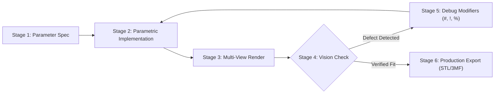

# OpenSCAD & BOSL2 Parametric CSG Modeling Reference

Declarative 3D CAD modeling, BOSL2 relative attachments, and headless CLI rendering with multimodal vision verification for OpenSCAD.

---

## 1. Headless Compiler, Guardrails & Render Matrix



| Dimension / Trap | Operational Hazard & Behavior | Required Affirmative Protocol |
| :--- | :--- | :--- |
| **SSA Variable Scope** | OpenSCAD assigns variables at compile time; reassignment shadows only locally | Use ternary expressions: `x = cond ? 10 : 5;` or list comprehensions: `[for (i = [0:5]) i * 10]` |
| **Transformation Semicolon** | Placing a semicolon directly after `translate()` terminates the transform with empty geometry | Always attach transforms directly to their child geometry block without semicolons |
| **Coincident Face Shimmer** | Coincident cut surfaces create zero-thickness non-manifold Z-fighting membranes | Always extend cutter geometry past targets: `translate([0, 0, -0.01]) cylinder(h=h + 0.02, d=d)` |
| **3D Print Tolerances** | Nominal CAD dimensions fuse mating parts during FDM slicing | Add `+0.4mm` clearance for loose slip fits, `+0.2mm` for normal fits, and `+0.1mm` for press fits |
| **Global `$fn` Freeze** | Setting fixed high `$fn` freezes viewport rendering on large scenes | Control resolution with `$fa` and `$fs`: `$fa = $preview ? 10 : 4; $fs = $preview ? 1.0 : 0.25;` |
| **Headless Binary Engine** | Legacy CGAL engine is 100x slower on complex booleans than modern Manifold | Always pass `--backend=manifold` on OpenSCAD CLI commands (Windows: use `openscad.com`) |

### Headless Compiler Discovery & Platform Paths

| Platform | Default Binary Path | Execution Notes |
| :--- | :--- | :--- |
| **Windows** | `C:\Program Files\OpenSCAD (Nightly)\openscad.com` | Always invoke `openscad.com` (console wrapper) to keep stdout attached. |
| **Linux** | `/usr/bin/openscad` or `flatpak run org.openscad.OpenSCAD` | Standard system package path. |
| **macOS** | `/Applications/OpenSCAD.app/Contents/MacOS/OpenSCAD` | Headless binary inside application bundle. |

---

## 2. Core DSL & BOSL2 Attachment Matrix

Include BOSL2 via `include <BOSL2/std.scad>`:

| Feature / Technique | Syntax Pattern | Behavioral Rule / Capability |
| :--- | :--- | :--- |
| **Tag-Based CSG** | `diff() { cuboid(...) { tag("remove") cyl(...); } }` | Declarative boolean subtraction: child tagged with `"remove"` cuts parent. |
| **Relative Positioning**| `position(TOP + RIGHT) cyl(...)` | Moves child to bounding anchor of parent without manual coordinate math. |
| **Relative Orientation**| `orient(UP)` or `align(BOTTOM)` | Automatically reorients child vector along parent surface normal. |
| **Edge & Corner Fillets**| `cuboid([w, d, h], rounding=3, edges="Z")` | Built-in rounded corners along specified axes (`"Z"`, `"ALL"`, `[TOP+RIGHT]`). |
| **Bottom Bed Chamfer** | `cuboid([w, d, h], chamfer2=0.6, anchor=BOTTOM)` | Inverts bottom edge chamfer to eliminate FDM print elephant's foot. |
| **Linear Distributors**| `xcopies(spacing, n=4) cyl(...)` | Replicates geometry along X axis centered at local origin. |
| **Rotary Distributors**| `rot_copies(n=6, r=20) cyl(...)` | Evenly distributes instances in a circle at radius `r`. |
| **Continuous Sweeps** | `path_sweep(circle(r=2), path)` | Sweeps 2D cross-section along 3D Bezier or spline trajectory. |
| **Hardware Masks** | `bolt(spec="M3x10", head="socket")` | Standard screw, nut-trap, and thread masks from `BOSL2/screws.scad`. |

---

## 3. Parametric Recipes & Verification

### Example 1: Idiomatic BOSL2 Mounting Bracket

```openscad
// Parametric Sensor Mounting Bracket (Idiomatic BOSL2 Architecture)
include <BOSL2/std.scad>

/* [Bracket Dimensions] */
base_w      = 40.0;
base_d      = 30.0;
base_h      = 4.0;
wall_h      = 28.0;
wall_t      = 3.5;

/* [Fasteners & Tolerances] */
hole_d      = 3.4;  // M3 clearance (+0.4mm tolerance)
hole_inset  = 7.0;
boss_od     = 10.0;
boss_id     = 4.5;

/* [Resolution Tuning] */
$fa = $preview ? 10 : 4;
$fs = $preview ? 1.0 : 0.25;

module sensor_bracket() {
    tag_scope() {
        diff() {
            // 1. Base Plate with Rounded Corners & Chamfered Bottom Bed Contact
            cuboid([base_w, base_d, base_h], rounding=3, edges="Z", chamfer2=0.6, anchor=BOTTOM) {
                
                // 2. Base Mounting Holes via Linear Distributors
                tag("remove")
                    xcopies(base_w - 2 * hole_inset)
                        ycopies(base_d - 2 * hole_inset)
                            cyl(h=base_h + 1, d=hole_d);

                // 3. Upright Wall Attached to Rear Edge
                position(BACK + TOP)
                    cuboid([base_w, wall_t, wall_h], rounding=2, edges="Y", anchor=BACK + BOTTOM) {
                        
                        // 4. Sensor Boss Attached to Front Face of Wall
                        position(FRONT + TOP)
                            cyl(d=boss_od, h=6, anchor=BACK + TOP) {
                                tag("remove")
                                    cyl(d=boss_id, h=10);
                            }
                    }
            }
        }
    }
}

sensor_bracket();
```

### Example 2: Headless Multi-View Render & Verification

```powershell
# Stage 1: Render isometric overview with Manifold engine
openscad.com -o bracket_iso.png --camera=0,0,0,55,0,25,120 --imgsize=1024,768 --colorscheme="Tomorrow Night" --backend=manifold bracket.scad

# Stage 2: Render top-down orthographic view for hole alignment inspection
openscad.com -o bracket_top.png --projection=o --camera=0,0,0,0,0,0,100 --backend=manifold bracket.scad

# Stage 3: Export production STL and verify output file size
openscad.com -o bracket.stl --backend=manifold bracket.scad
Get-Item bracket.stl | Select-Object Name, Length
```
