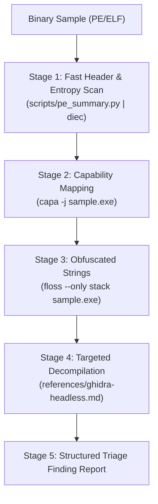

# Executable & Binary Malware Triage (PE & ELF) Reference

Static triage, capability extraction, and targeted reverse engineering for Windows binaries (`.exe`, `.dll`, `.sys`) and Linux binaries (`ELF`) without host execution.

---

## 1. Programs & Toolchain Used

| Program / Tool | Role / Purpose |
| :--- | :--- |
| **`scripts/pe_summary.py`** | Bundled Python script: fast-path extraction of SHA256, section entropy, ImpHash, and flagged APIs |
| **`capa`** | Automated capability detection and MITRE ATT&CK / MBC behavior mapping |
| **`floss`** | Extraction of plain, stack-allocated, and decoded obfuscated strings |
| **`diec` (Detect-It-Easy)** | Compiler, packer, and section entropy detection CLI |
| **`pefile` / `readelf`** | Parsing PE/ELF headers, section entropy, symbols, and imports |
| **`analyzeHeadless` (Ghidra)**| Targeted headless decompilation of flagged injection/C2 functions (`references/ghidra-headless.md`) |

---

## 2. Safety & Host Isolation Guardrails

| Hallucination / Mistake | Why It Fails | Correct Protocol / Syntax |
| :--- | :--- | :--- |
| Bare execution `./sample.exe` | Infects local host environment (severe security incident) | **NEVER execute target binaries.** Inspect strictly with static analysis tools |
| DLL invocation via `rundll32` | Executes malicious DLL entrypoints on host | Dissect export directory statically via `pefile` or `diec` |
| Full-binary decompilation | Decompiling entire 20MB binary exhausts RAM and token budget | Decompile only targeted functions (see [`references/ghidra-headless.md`](references/ghidra-headless.md)) |
| Bare-metal dynamic debugging | Debuggers execute instructions on host | Dynamic analysis belongs strictly in isolated VMs (FlareVM/Windows Sandbox) |

---

## 3. Investigation Funnel Pipeline Matrix



| Stage | Operation / Focus | Exact Tool Command | Finding Signal / Triaged Indicator |
| :--- | :--- | :--- | :--- |
| **1. Header & Entropy** | Packer & Section Scan | `diec -e suspect.exe`<br/>`readelf -h suspect.elf` | Section entropy $>7.2$ indicates packing (UPX, Themida, VMProtect). |
| **2. Capabilities** | MITRE ATT&CK Mapping | `capa -j suspect.exe > capa.json` | Flags process injection (`T1055`), persistence (`T1547`), evasion (`T1027`). |
| **3. Strings** | Network & C2 Artifacts | `floss --only stack suspect.exe` | Extracts stack-built C2 URLs, IP addresses, registry run keys, payloads. |
| **4. Decompilation** | Targeted Function C | `analyzeHeadless ... DecompileTargetFunction.py` | Disassembles and decompiles flagged injection or crypto routines to C. |

---

## 4. Structured Output / Finding Schema

```markdown
### 🛡️ Malware Triage Assessment: `<FILENAME>`
* **Hashes:** SHA256: `<HASH>` | ImpHash: `<IMPHASH>`
* **Architecture / Type:** `<PE32+/ELF64>` | Packer: `<UPX / None>` (Entropy: `<SCORE>`)
* **ATT&CK Capabilities:**
  - `T1055.012` Process Hollowing (calls `VirtualAllocEx`, `WriteProcessMemory`, `ResumeThread`)
  - `T1027.007` Dynamic API Resolution via PEB
* **Extracted IOCs:**
  - Network C2: `http://198.51.100.23:8080/beacon`
  - Persistence: `HKCU\Software\Microsoft\Windows\CurrentVersion\Run`
```

---

## 5. High-Leverage Composite Triage Examples

```bash
# 1. Fast-path triage using bundled helper (extracts hashes, entropy, and risky APIs)
python scripts/pe_summary.py suspect.exe

# 2. Windows PE static triage pipeline: packer scan, capability extraction, and stack strings
diec -e suspect.exe
capa -j suspect.exe | jq -r '.rules | to_entries[] | select(.value.meta.attck != null) | "\(.value.meta.attck[0]) - \(.key)"'
floss --only stack suspect.exe | grep -E -i "(https?://|[0-9]{1,3}\.[0-9]{1,3}\.[0-9]{1,3}\.[0-9]{1,3}|cmd\.exe|powershell)"

# 3. Linux ELF binary inspection and symbol triage
readelf -h suspect.elf
readelf --symbols suspect.elf | grep -E -i "(connect|socket|fork|exec|ptrace)"
capa suspect.elf
```
