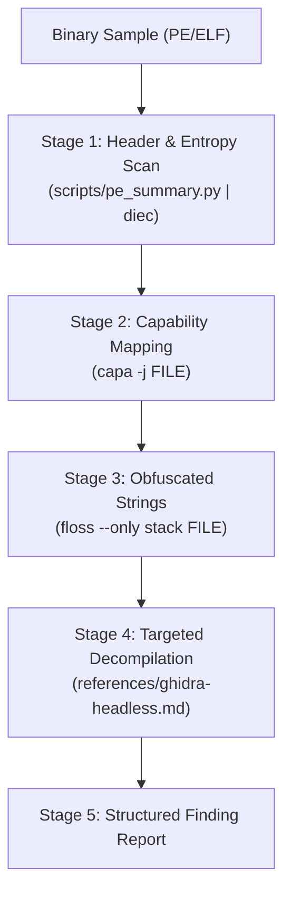

# Executable & Binary Malware Triage (PE & ELF) Reference

Static triage, capability extraction, and targeted reverse engineering for Windows binaries (`.exe`, `.dll`, `.sys`) and Linux binaries (`ELF`) without host execution.

---

## 1. Toolchain, Quarantine & Circuit Breakers

| Tool / Fast-Path | Operational Role & Capabilities | Safety Protocol / Circuit Breaker |
| :--- | :--- | :--- |
| **`uv run scripts/pe_summary.py`** | Fast-path header, entropy, ImpHash, and API extraction | Primary triage command: run first for token-bounded JSON summary. |
| **Host Execution Isolation** | Direct execution or DLL loading compromises host security | Never execute suspect binaries directly; analyze strictly using static tools. |
| **Packed Binary Circuit Breaker** | Packed or protected binaries cause capa to return zero rules | If capa fails on packed code, run `diec -e FILE` and pivot to `floss --only stack FILE`. |
| **Full Decompilation Protection** | Decompiling entire 20MB binaries exhausts subshell memory | Decompile only targeted functions (see `references/ghidra-headless.md`). |
| **`capa` / `floss` / `diec`** | MITRE ATT&CK mapping, string deobfuscation, and packer detection | Run headlessly with `-j` (JSON) or `--only stack` for high-signal extraction. |

---

## 2. Investigation Funnel Matrix



| Stage | Operation / Focus | Exact Tool Command | Finding Signal / Triaged Indicator |
| :--- | :--- | :--- | :--- |
| **Stage 1: Header & Entropy Scan** | Packer & Section Scan | `uv run scripts/pe_summary.py FILE`, `diec -e FILE` | Section entropy > 7.2 indicates packing (UPX, Themida, VMProtect). |
| **Stage 2: Capability Mapping** | MITRE ATT&CK Mapping | `capa -j FILE > capa.json` | Flags process injection (`T1055`), persistence (`T1547`), evasion (`T1027`). |
| **Stage 3: Obfuscated Strings** | Network & C2 Artifacts | `floss --only stack FILE` | Extracts stack-built C2 URLs, IP addresses, registry run keys. |
| **Stage 4: Targeted Decompilation** | Targeted Function C | `analyzeHeadless . tmp -import FILE -postScript scripts/DecompileTargetFunction.py` | Disassembles and decompiles flagged injection or crypto routines. |

---

## 3. Tool Flag Reference

| Tool | Subcommand / Flags | Output Format | Purpose |
| :--- | :--- | :--- | :--- |
| **`diec`** | `-e`, `-j` | JSON / Text | Section entropy and compiler/packer detection. |
| **`capa`** | `-j`, `-v` | Structured JSON | MITRE ATT&CK technique mapping. |
| **`floss`** | `--only stack`, `--only decoded` | Clean text lines | Extracts obfuscated and stack-allocated string literals. |
| **`readelf`** | `-h`, `--symbols` | Text tables | ELF header architecture and symbol table introspection. |

---

## 4. Structured Output / Finding Schema

```markdown
### Malware Triage Assessment: FILENAME
* **Hashes:** SHA256: HASH | ImpHash: IMPHASH
* **Architecture / Type:** ARCH_TYPE | Packer: PACKER_NAME (Entropy: SCORE)
* **ATT&CK Capabilities:**
  - `T1055.012` Process Hollowing (calls `VirtualAllocEx`, `WriteProcessMemory`, `ResumeThread`)
  - `T1027.007` Dynamic API Resolution via PEB
* **Extracted IOCs:**
  - Network C2: `hxxp://198.51.100[.]23:8080/beacon`
  - Persistence: `HKCU\Software\Microsoft\Windows\CurrentVersion\Run`
```

---

## 5. High-Leverage Composite Triage Examples

```bash
# Stage 1: Header & Entropy Scan using bundled helper script
uv run scripts/pe_summary.py suspect.exe

# Stage 2: Capability Mapping with JSON parsing and finding verification
capa -j suspect.exe > capa.json
jq -r '.rules | to_entries[] | select(.value.meta.attck != null) | "\(.value.meta.attck[0]) - \(.key)"' capa.json

# Stage 3: Obfuscated Strings extraction for C2 beacon detection
floss --only stack suspect.exe | grep -E -i "(https?://|[0-9]{1,3}\.[0-9]{1,3}\.[0-9]{1,3}\.[0-9]{1,3}|cmd\.exe|powershell)"

# Stage 4: Targeted Decompilation & Linux ELF symbol triage
readelf -h suspect.elf
readelf --symbols suspect.elf | grep -E -i "(connect|socket|fork|exec|ptrace)"
```
