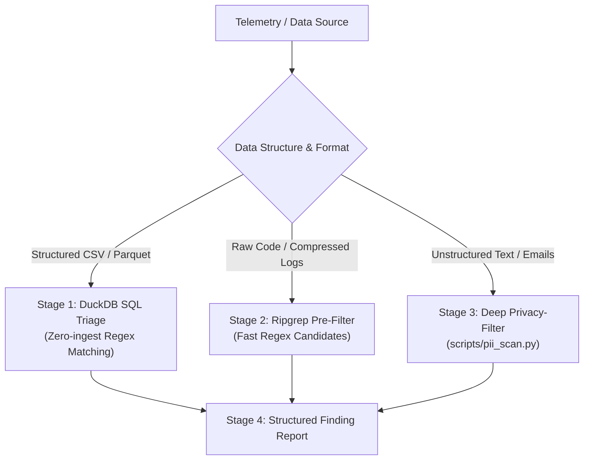

# PII & Sensitive Data Detection Reference

Automated discovery, classification, and redaction of Personally Identifiable Information (PII) across logs, emails, customer tickets, JSON/CSV datasets, and git repositories using the **`openai/privacy-filter`** token classification model, **DuckDB SQL**, and **ripgrep (`rg`)**.

---

## 1. Toolchain, Quarantine & Circuit Breakers

| Tool / Fast-Path | Operational Role & Capabilities | Safety Protocol / Circuit Breaker |
| :--- | :--- | :--- |
| **`uv run scripts/pii_scan.py`** | Fast-path grep-style contextual scanner (`-C 1`) with CSV/JSONL export | Primary triage command: run first for contextual text and unstructured logs. |
| **Model Verification** | Typosquatted Hugging Face forks can execute malicious payloads | Use strictly the official upstream model: `openai/privacy-filter`. |
| **Air-Gapped Regex Pre-Filter** | Deep ML classifiers have GPU/CPU inference overhead on large dumps | Run ripgrep regex pre-filters first; pass matched candidate slices to ML filter. |
| **Large Tabular Zero-Ingest** | Scanning multi-gigabyte CSV/Parquet dumps line-by-line is slow | Use DuckDB SQL regex scans for instant in-process columnar triage. |
| **Output Bounding** | Printing raw PII unmasked to terminals leaks sensitive credentials | Enforce `-C 1` context bounds and export findings directly to CSV/JSONL. |

---

## 2. Investigation Funnel Matrix



| Stage | Operation / Focus | Exact Tool Command | Finding Signal / Triaged Indicator |
| :--- | :--- | :--- | :--- |
| **Stage 1: DuckDB SQL Triage** | Tabular Pattern Matching | `duckdb -markdown -bail -c "SELECT ..."` | High-speed identification of SSN, Credit Card, and Email columns. |
| **Stage 2: Ripgrep Pre-Filter** | Raw Code & Compressed Log Scan | `rg -n -C 1 -e "REGEX" TARGET_DIR` | Rapid candidate line filtering across gigabytes of raw source text. |
| **Stage 3: Deep Privacy-Filter** | Contextual Name & Address Scan | `uv run scripts/pii_scan.py TARGET_DIR` | Discovers nuanced human names, physical addresses, and medical dates. |

---

## 3. PII Detection Engines & Taxonomy Matrix

| Category | Target Entity Types | Real-World Examples & Patterns |
| :--- | :--- | :--- |
| **`PRIVATE_PERSON`** | Human names, employee identities | `Marcus Sterling`, `Dr. Julian Bashir`, `Sarah Connor` |
| **`PRIVATE_EMAIL`** | Personal and corporate direct emails | `marcus.sterling88@gmail.com`, `richard@piedpiper.com` |
| **`PRIVATE_PHONE`** | Mobile, landline, international numbers | `+1 (650) 555-2948`, `+61 412 555 839` |
| **`PRIVATE_ADDRESS`** | Street and residential physical addresses | `1422 Victoria Street, Potts Point, NSW 2011`, `350 5th Ave, NY` |
| **`ACCOUNT_NUMBER`** | SSNs, Tax IDs, bank accounts, credit cards | `482-194-883`, `Visa 4532-8819-2049-1102` |
| **`PRIVATE_DATE`** | Dates of birth, medical treatment dates | `DOB: 1984-11-04`, `August 25, 2026 through September 15, 2026` |
| **`SECRET`** | Leaked bearer tokens, API keys, passwords | High-entropy strings, JWT headers, private key anchors. |

---

## 4. Structured Output / Finding Schema

```markdown
### PII Audit Assessment: TARGET_PATH
* **Total Records Audited:** TOTAL_COUNT | Detected Violations: VIOLATION_COUNT
* **Classification Breakdown:**
  - `PRIVATE_PERSON`: 14 instances (Customer service email bodies)
  - `ACCOUNT_NUMBER`: 2 instances (Unmasked credit card numbers in debug logs)
* **High-Risk Snippets:**
  - File: `logs/auth.log:142` -> `ACCOUNT_NUMBER: 4532-****-****-1102`
* **Remediation Recommendation:** Mask fields in logging middleware before ingestion.
```

---

## 5. High-Leverage Composite Triage Examples

```bash
# Stage 1: DuckDB SQL Triage on tabular CSV using zero-ingestion regex
duckdb -markdown -bail -c "
SELECT line_number, service, message,
  CASE
    WHEN regexp_matches(message, '\b\d{3}-\d{2}-\d{4}\b') THEN 'SSN'
    WHEN regexp_matches(message, '\b(?:\d{4}[-\s]?){3}\d{4}\b') THEN 'CREDIT_CARD'
    WHEN regexp_matches(message, '[a-zA-Z0-9._%+-]+@[a-zA-Z0-9.-]+\.[a-zA-Z]{2,}') THEN 'EMAIL'
    ELSE 'CLEAN'
  END AS pii_type
FROM read_csv('enterprise_logs.csv', header=true)
WHERE pii_type != 'CLEAN' LIMIT 20;
"

# Stage 2: Ripgrep Pre-Filter with output bounds
rg -n -C 1 -e "\b\d{3}-\d{2}-\d{4}\b" -e "[a-zA-Z0-9._%+-]+@[a-zA-Z0-9.-]+\.[a-zA-Z]{2,}" src/ | head -n 25

# Stage 3: Deep Privacy-Filter scan using bundled helper script with CSV report export
uv run scripts/pii_scan.py ./scratch/test_emails/ -C 1 --min-confidence 0.85 --output-csv findings.csv
wc -l findings.csv
```
