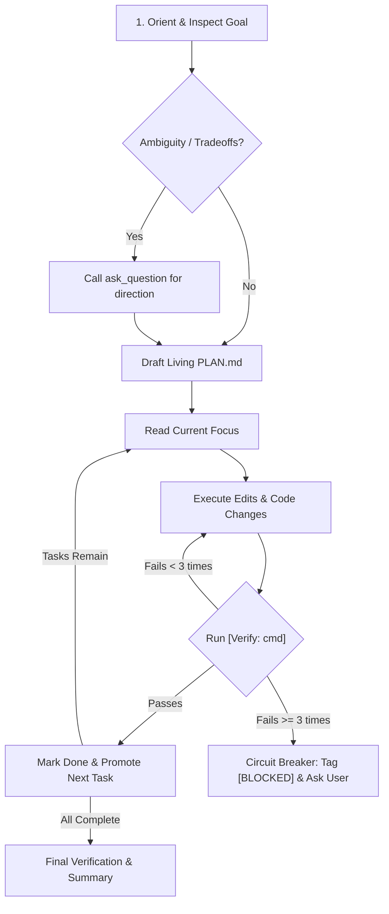

# Plan & Execute Workflow Loop Reference

A deterministic state machine for multi-step tasks (3+ dependent steps) using a living `PLAN.md` file with phase gates, explicit verification commands, and automated circuit breakers.

---

## 1. Trigger Criteria & Negative Guardrails

| Hallucination / Mistake | Why It Fails | Correct Protocol / Syntax |
| :--- | :--- | :--- |
| Creating `PLAN.md` for 1-step edits | Adds unnecessary overhead to trivial bug fixes | Execute single-file edits directly without `PLAN.md` |
| Creating `PLAN.md` for Q&A | Fails to answer investigatory questions promptly | Answer "how does X work" directly; do NOT create a plan |
| Clearing the `Done` section | Destroys execution history and context memory | **Never erase `Done` tasks.** Append newly completed tasks |
| Looping on failed tests ($>3$ times) | Burns token budget on repetitive failed attempts | **Stop at 3 attempts (Circuit Breaker)**; tag `[BLOCKED]` and ask user |
| Missing verification commands | Tasks marked complete without validation | Every task must include inline `[Verify: <cmd>]` tag |

---

## 2. Living `PLAN.md` Template Schema

Maintain this exact structure in `PLAN.md` throughout execution:

```markdown
# PLAN — [Brief Feature / Project Name]

## Goal
- **Original Goal:** [Single sentence definition of done]
- **Acceptance Criteria:**
  - [ ] Criterion 1
  - [ ] Criterion 2

## Current Focus
- [ ] Active single task [Verify: `<cmd>`] [Artifacts: `<files>`]

## Up Next
- [ ] Dependent second task [Verify: `<cmd>`]
- [ ] Dependent third task [Verify: `<cmd>`]

## Discovered / Backlog
- [ ] [BLOCKER] Newly discovered roadblock
- [ ] [DEFERRED] Non-blocking discovery

## Done
- [x] Initial setup and verification (Verified: `<output>`)
```

---

## 3. Workflow State Machine



---

## 4. Subagent Delegation & Offloading Matrix

| Task Characteristics | Execution Mode | Rationale & Safety |
| :--- | :--- | :--- |
| **Sequential / Coupled Code** | **Inline Agent** | Preserves shared working memory and immediate feedback loop. |
| **Core Architecture Refactoring** | **Inline Agent** | Prevents context fragmentation and workspace merge conflicts. |
| **Parallel Independent Modules** | **Subagent** (`invoke_subagent`) | High speed; independent subagents operate concurrently without context bloat. |
| **Deep Read-Only API Research** | **Research Subagent** (`TypeName: "research"`) | Prevents massive web/manual dumps from cluttering conversation context. |
| **Batch Test / Docstring Sweeps** | **Self Subagent** (`TypeName: "self"`) | Offloads repetitive file writes; returns structured completion report. |


## Completion Gate & Review

When all tasks in `Up Next` are empty and `Discovered` has no remaining `[BLOCKER]` items:

1. Read through `Done` to verify all acceptance criteria were satisfied.
2. Run full test suite / build checks across the workspace.
3. **Review Gate**: Review the full diff or modified files to verify no security or logic regressions were introduced.
4. Tell the user you are done and provide a concise summary of deliverables and any `[DEFERRED]` backlog items.
