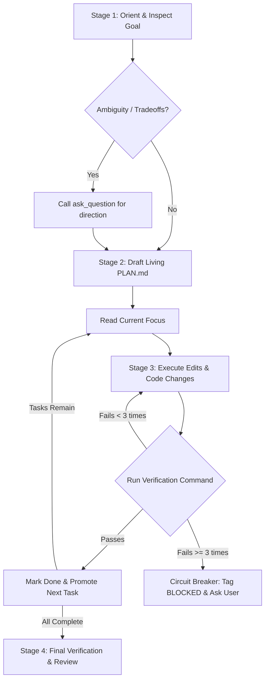

# Plan & Execute Workflow Loop Reference

A deterministic state machine for multi-step tasks (3+ dependent steps) using a living `PLAN.md` file with phase gates, explicit verification commands, and automated circuit breakers.

---

## 1. Process State Machine & Circuit Breakers



| Primitive / Trap | Operational Hazard & Behavior | Required Affirmative Protocol |
| :--- | :--- | :--- |
| **Over-Engineering Trivial Tasks** | Creating `PLAN.md` for 1-step edits adds unnecessary overhead | Execute single-file edits directly without creating `PLAN.md` |
| **Investigatory Question Trap** | Creating a plan when asked "how does X work" delays answers | Answer investigatory questions directly without creating a plan |
| **Done Section Erasure** | Clearing completed tasks destroys execution history and context memory | Never erase `Done` entries; continuously append newly completed items |
| **3-Strike Circuit Breaker** | Looping on failing tests repeatedly burns conversation tokens | Stop after 3 failed attempts; tag `[BLOCKED]` in `PLAN.md` and query user |
| **Missing Verification Checks** | Marking tasks complete without validation causes silent failures | Every task in `PLAN.md` must include an explicit `[Verify: COMMAND]` check |

---

## 2. Confirmation & Subagent Delegation Gates

| Task Characteristics | Execution Mode | Rationale & Safety |
| :--- | :--- | :--- |
| **Sequential / Coupled Code** | **Inline Agent** | Preserves shared working memory and immediate feedback loop. |
| **Core Architecture Refactoring** | **Inline Agent** | Prevents context fragmentation and workspace merge conflicts. |
| **Parallel Independent Modules** | **Subagent** (`invoke_subagent`) | High speed; independent subagents operate concurrently without context bloat. |
| **Deep Read-Only API Research** | **Research Subagent** (`research`) | Prevents massive web/manual dumps from cluttering conversation context. |
| **Batch Test / Docstring Sweeps** | **Worker Subagent** (`self`) | Offloads repetitive file writes; returns structured completion report. |

### Completion Gate & Review Protocol

When all tasks in `Up Next` are empty and `Discovered` has no remaining `[BLOCKED]` items:
1. Verify all acceptance criteria were satisfied against the `Done` log.
2. Run full test suite or build checks across the workspace.
3. Review `git diff --stat` to verify no regressions were introduced.
4. Notify user of completion with a concise summary of deliverables and any deferred backlog items.

---

## 3. Artifact & Config Schema (`PLAN.md`)

Maintain this structure in `PLAN.md` throughout execution:

```markdown
# PLAN — [Brief Feature / Project Name]

## Goal
- **Original Goal:** Single sentence definition of done
- **Acceptance Criteria:**
  - [ ] Criterion 1
  - [ ] Criterion 2

## Current Focus
- [ ] Active single task [Verify: COMMAND] [Artifacts: FILE_LIST]

## Up Next
- [ ] Dependent second task [Verify: COMMAND]
- [ ] Dependent third task [Verify: COMMAND]

## Discovered / Backlog
- [ ] [BLOCKED] Roadblock requiring user intervention
- [ ] [DEFERRED] Non-blocking discovery for follow-up

## Done
- [x] Initial setup and verification (Verified: OUTPUT_SUMMARY)
```

---

## 4. High-Leverage Composite Examples

```bash
# Stage 1: Initialize living PLAN.md for a multi-step refactor
cat << 'EOF' > PLAN.md
# PLAN — Migrate User Service to TypeScript

## Goal
- **Original Goal:** Convert src/services/user.js to TypeScript with strict type checking.
- **Acceptance Criteria:**
  - [ ] src/services/user.ts compiles with zero TypeScript errors
  - [ ] Existing user test suite passes

## Current Focus
- [ ] Rename user.js to user.ts and declare user interfaces [Verify: npx tsc --noEmit]

## Up Next
- [ ] Update imports across callers [Verify: npm test]

## Done
EOF

# Stage 2: Execute phase change, run verification command, and check git diff
npx tsc --noEmit
git diff --stat
```
