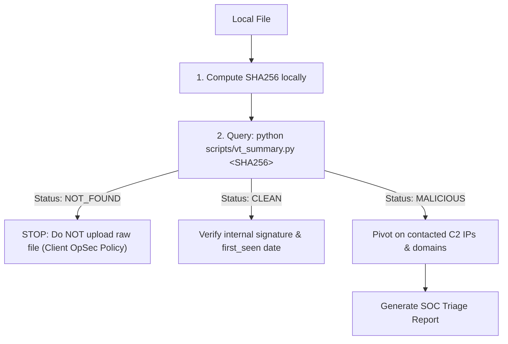

# VirusTotal CLI (`vt-cli`) Skill

Automated threat intelligence and DFIR investigations using `vt-cli`. Enforces strict OpSec (hash-first, zero accidental sample uploads) and token-efficient JSON querying.

---

## 1. Programs Used

| Program / Tool | Role / Purpose |
| :--- | :--- |
| **`scripts/vt_summary.py`** | Bundled Python fast-path helper that emits a clean, 15-line JSON triage summary |
| **`vt-cli` (`vt`)** | Official binary to query hashes, IPs, domains, and behavioral relationships |
| **`jq`** | Filter and slice raw VT API output when custom queries are required |
| **`sha256sum` / `Get-FileHash`** | Compute local SHA256 hashes prior to querying |

---

## 2. Authentication & Pre-Flight Quota Check

```bash
# Set API key (bash)
export VTCLI_APIKEY="<YOUR_API_KEY>"
# Set API key (PowerShell)
$env:VTCLI_APIKEY = "<YOUR_API_KEY>"

# Pre-flight quota check (prevent hung jobs on exhausted limits)
vt user <API_KEY_OR_USERNAME> -i id,quotas --format json
```

---

## 3. Strict Deterministic Triage Workflow

Follow this sequence strictly:



### Fast-Path: Bundled Triage Script (Zero `jq` Required)
```bash
# Runs hash query and extracts verdict, threat label, imphash, and top C2s:
python scripts/vt_summary.py <SHA256>
```
* **Exit Codes:** `0` = Clean/Unknown, `2` = Malicious, `3` = Not Found on VT (STOP).

---

## 4. Negative Guardrails (Small Model Safety)

| Hallucination / Mistake | Why It Fails | Correct Command / Flag |
| :--- | :--- | :--- |
| `vt scan <HASH>` | Hashes are queried with `vt file`, not `vt scan` | `vt file <SHA256>` |
| `vt scan file <PATH> --private` | `--private` flag does NOT exist on `vt scan file` | Never upload without private portal access |
| `vt file <HASH> --download` | Download is a separate top-level command | `vt download <SHA256> -o <DIR>` |
| `vt file behaviors <HASH>` | VT API uses UK spelling (`behaviours`) | `vt file behaviours <HASH>` |
| `-m`, `--scan-all`, `--deep` | Flags do not exist | Use `--format json` or `-i <FIELDS>` |
| `jq '.meaningful_name'` | Root JSON output is an array `[...]` | `jq '.[0].meaningful_name'` |

---

## 5. Manual CLI Queries (When Bypassing Helper Script)

Always use explicit placeholders: `<SHA256>`, `<IP>`, `<DOMAIN>`, `<URL>`.

### Hash & Infrastructure Inspection
```bash
# Hash lookup (token-bounded field filter)
vt file <SHA256> -i meaningful_name,type_description,last_analysis_stats --format json

# IP reputation and ASN
vt ip <IP>

# Domain categories and DNS records
vt domain <DOMAIN>

# Submit and scan a public URL (waits for result)
vt scan url "<URL>" --wait
```

### Relationship Exploration
```bash
# Contacted C2 IPs (identifiers only, one per line)
vt file contact_ips <SHA256> -I --limit 25

# Contacted domains (identifiers only)
vt file contact_domains <SHA256> -I --limit 25

# Files dropped during sandbox execution
vt file dropped_files <SHA256> -I --limit 25

# Find all malware observed communicating with a C2 IP
vt ip communicating_files <IP> -I --limit 25
```

---

## 6. Threat Hunting Queries (`vt search`)

Query the VirusTotal Intelligence corpus. Always use `-I` (identifiers-only) and `--limit`:

```bash
# Pivot by code-signing certificate subject
vt search 'tag:signed signer:"<CERT_SUBJECT>" type:peexe' -I --limit 20

# Pivot by ImpHash and PE section count
vt search 'imphash:<IMPHASH> section_count:<COUNT>' -I --limit 20

# Find binaries communicating with suspect C2 IP
vt search 'net_communication:"<IP>" type:peexe' -I --limit 20

# Search malicious Office documents submitted recently
vt search 'tag:macro tag:vba tag:exploit submissions:2026-08*' -I --limit 20
```

*For continuous Livehunt YARA rules and historical Retrohunt jobs, see **[references/retrohunt.md](references/retrohunt.md)**.*

---

## 7. Triage Report Schema

```markdown
### 🛡️ VirusTotal Intelligence Summary: `<SHA256>`

* **Verdict:** `Malicious` (Score: `<MALICIOUS>/<TOTAL>`)
* **Classification:** `<THREAT_LABEL>` (e.g. `Trojan.Win64.Stealer / RedLine`)
* **File Details:** `<TYPE_DESCRIPTION>` | ImpHash: `<IMPHASH>`

#### 🌐 Identified C2 Infrastructure:
| Type | Indicator | Context |
| :--- | :--- | :--- |
| **IP** | `<IP_ADDRESS>` | Communicating Sample / Sandbox Beacon |
| **Domain** | `<DOMAIN>` | C2 Host / Dropper URL |

#### 📂 Dropped Artifacts:
* `<FILENAME>` (`SHA256: <SHA256>`)
```
